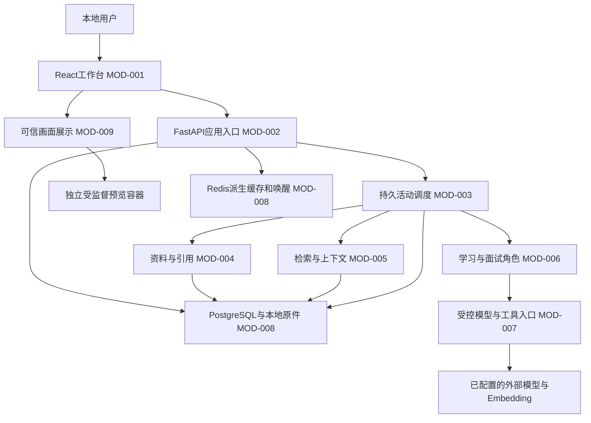

> **只读历史／已迁移（2026-09-13，Asia/Shanghai）**：当前唯一有效文件见 [docu/PROJECT_ARCHITECTURE.MD](../../docu/PROJECT_ARCHITECTURE.MD)。依据用户V3指令保留以下原文，不再双写；旧“当前/下一步/待批准”只属于原时点，不能作为现行动作。流程和导航已并入执行状态，全部旧编号与记录保留。

# PROJECT_ARCHITECTURE

## 1. 文档信息

- 项目：RetroLume / 溯光教育Agent；版本：v0.11；文档状态：待批准。
- 需求基线：LATER_REQUIREMENTS.md v1.0（当前有效，2026-09-10用户明确批准）。
- 创建：2026-09-10；更新：2026-09-11；最近关联变更：CHG-0201；初始架构，执行映射见PROJECT_EXECUTE_STATE。
- 本文是唯一架构事实源。除本轮FILE-008原件文件层及FILE-011/012最小工程部分已实现外，业务MOD/FLOW/DATA/API及其余FILE均为“计划中”，不代表业务已经实现；ADR按各项状态记录：ADR-006/008的方案取舍已获用户确认，状态为计划中；其余待完整架构批准。风险项状态单列。正文中计划路径、逻辑接口及概念实体均尚未创建，不是代码签名或正式数据库表。
- 当前为新项目设计：初次创建前未发现既有架构文件或正式业务实现。原SPIKE及外部实验目录只提供有限证据，不作为产品模块。根AGENTS适用，祖先未发现其他规则；WORK.md不存在，遵循用户对话Work规则。项目处于上级Obsidian Git仓库，本轮不提交或改动其他项目。

## 2. 依据、边界与未确认项

事实输入：REQUIREMENTS v0.2、OPEN_SOURCE_RESEARCH v0.1历史来源、TECHNICAL_FEASIBILITY v0.22第13.7、FLOW v1.0第9节。需求已批准，初评高/高/高经实验证据校准为复杂度高、不确定性中、交付风险高。用户选择自有应用加必要组件，DeepTutor v1.6.4仅参考，首版个人Windows本地、学习闭环优先且文字面试必须可用。

实验事实：文字/MD/普通PDF及原件回查有证据；复杂PDF错序仍在，016仅模拟人工核对和片段重排。009向量、011原件、015同名词项样本是不同实验，未证明完整产品一条链。013续答与015面试正对照只支持小样本。012/014停止恢复、008HTML局部边界有必要隔离审计，不证明本架构实现已安全。原失败、费用未知和HYP-006路线停止保留。

边界：单人本地，原件/证据/学习记录保留至用户删除；外部服务只收到活动必要片段，显示服务及用途。所有PDF核对后供学习，文字/TXT/MD保留自动路径。图片/Office/扫描件和扩展资料为Should，语音Could，公开服务及实时面试Won't for now。无固定首学科、无全领域正确性承诺。不增加教师/机构、多租户、计费平台、集群或自动互联网研究功能。

推断与建议：单体业务边界配独立worker足以支持当前单用户；数据库任务领取可省去独立队列框架。该判断未做产品性能实验，若实际目标并发/容量无法满足再重评。2026-09-11用户已明确确认代码根D:/shuice12/RetroLume、资料根D:/shuice12/RetroLume-data、备份根D:/shuice12/RetroLume-backups；三者独立于旧实验，目录已创建且为空。FILE计划路径均相对正式代码根；正式文档仍保留在当前Obsidian项目目录，不复制第二套事实源。目录存在不等于模块实现或备份恢复可用。

本架构整体待批准；Redis8按RSALv2个人本地使用与独立Docker预览方向已获用户确认。核心依赖组合仍需书面核定，未授权安装。本轮按用户最新指令同时编制执行候选，不把文档编制授权解释为架构、执行基线或开发批准。

## 3. 总体结构与模块

浏览器不直接访问数据库或模型。API接收短操作，长解析/模型调用在同一后端代码库的独立worker进程执行；两者共享领域规则而非两套实现。业务状态以PostgreSQL为准，Redis失效可回源恢复；HTML只能显示受限交互，不能调用API工具。模块划分是代码职责，不是九个微服务。

| ID / 状态 | 职责与需求 | 输入→输出 / 依赖方向 | 明确不负责 |
| --- | --- | --- | --- |
| MOD-001 / 计划中 | 工作台：资料核对、学习/面试、证据侧栏、记忆及预算可视；FR-001～012 | 用户动作→API命令，事件→可理解进度；依赖002/009 | 密钥、事实裁决、任务预算授权 |
| MOD-002 / 计划中 | HTTP入口、会话与请求校验、幂等命令；SEC-001/002、NFR-002 | 用户命令→持久命令/返回活动ID；调用003/004/008 | 长任务执行、提示词内权限判断 |
| MOD-003 / 计划中 | 活动状态机、worker任务领取、限额/取消/恢复、合法迁移；NFR-002/003/005 | 活动状态及用户事件→下一合法动作或等待；调用004～008 | 让模型任意改活动/预算、把缓存当进度 |
| MOD-004 / 计划中 | 逐文件导入/解析、核对、版本替换、原件引用回查；FR-001/003/004、DR-001/003 | 原件/确认→版本化片段和引用；依赖008 | 自动证明所有复杂PDF语义正确、OCR/Office首版承诺 |
| MOD-005 / 计划中 | 范围检索、证据包、上下文配额、记忆投影；FR-003/004、NFR-001/005 | 问题/版本范围/活动→有限上下文及候选证据；依赖004/007/008 | 模型自行扩大范围、全历史无限拼接 |
| MOD-006 / 计划中 | 意图、计划、练习、反馈、复测、面试专业角色；FR-002/006～011 | 证据包及任务→结构化建议；依赖005/007 | 自建任务循环、直接数据库写入、把单次正确认定长期掌握 |
| MOD-007 / 计划中 | 模型适配、工具目录、参数/权限/结果校验、费用预留；INT-002/SEC-002 | 获准调用→有效结果/明确失败；依赖003预算及008记录 | 任意shell/Python执行、动态安装MCP、隐式重试 |
| MOD-008 / 计划中 | PostgreSQL/pgvector存储、文件库、派生Redis缓存、导出备份；DR-001～003 | 领域事务/原件→持久事实或副本；被002～007使用 | 教学推理、只靠Redis锁保证一致性 |
| MOD-009 / 计划中 | 受限HTML宿主与展示协议；FR-009/SEC-003 | HTML产物→独立容器画面/有限输入及失败提示；可信监督器控制 | 外部网络、父页数据、文件/系统/模型工具访问 |

## 4. 一条主链与多角色编排

### FLOW-001 / 计划中：资料进入可用范围

002逐文件持久化导入记录→原件写临时文件并完成hash核对/原子落位→004受限解析→保存原始提取与物理页/段/行定位→PDF进入待核对；TXT/MD按支持范围校验后可激活→用户确认/补正或跳过→005建立该版本索引。

文件失败只标该项。替换先保留旧活动版：候选解析失败不影响旧版；新PDF待核对期间明确显示旧版仍在用，禁止把新旧片段合成一版；核对及索引就绪后一次事务切换活动版本并提升范围修订号。旧活动历史可查看，但下一次生成需重建上下文或由用户明确新建历史范围活动，不能偷偷继续用旧版。

人工补正分两类：原文片段重排保留原页映射；纠字/新增解释保存为用户补充版本，不能冒充PDF原文。无可信位置的原文引用拒绝。重启时未完成临时件可定位恢复，不以缺少DB记录自动删除文件。坏格式、过大、加密/扫描无可提取文本显示具体原因及替换/跳过入口。

### FLOW-002 / 计划中：统一学习与面试活动

一次持久活动 = 范围快照 + 目标 + 模式 + 已确认记录 + 预算。主流程：意图/范围检查→必要追问→检索证据→生成当前教学或面试动作→校验→事务保存→展示/等待用户→收到回答→反馈→必要复测/追问→保存更新理由。学习/面试只是在动作类型和评价维度上分支，共用状态、证据、预算和恢复。

专业角色采用同一个模型服务上的独立提示与结构化输出：意图/计划角色、出题/面试角色、评价/复测角色、HTML解释角色。检索和权限检查是确定性服务。角色按需执行，不要求每轮调用全部角色；默认无角色间自由聊天或递归委派，不为“多Agent”额外开独立进程。只有不同独立资料的导入可有限并行；同一活动只允许一个有效执行代次。

动作输出含所依据的证据ID、回答/作答版本、可观察判断、原因假设、下一活动理由。003验证动作是否属于当前合法阶段，007验证格式/来源/数值及权限，006无法直接提升掌握或写业务状态。数学核算使用有限表达式运算工具而非eval/任意代码；开放回答用评价维度和证据，分离正确部分、缺证据部分及未知原因。自动语义评审不能保证正确，用户可修正且保留历史。

### FLOW-003 / 计划中：检索与证据链

1. 先按活动范围、可用/未删除版本、PDF核对状态过滤，再检索。查询与答案文本是资料，不是控制指令。
2. 首版pgvector精确余弦检索与本地词项通道融合：中文用规范化字符片段/词项匹配基线，英文词项匹配，均保留原文位置；不假定PostgreSQL默认分词能解决中文。合并采用排名融合及同源去重；参数在阶段06用中英代表样例冻结。
3. 保留可定位的页/段结构，长片段切分附原位置区间，邻近扩展不能跨版本/来源；表格/复杂布局不自动线性推断，沿人工核对后的内容。
4. Embedding负责文本→向量；pgvector负责存储/距离，不替代模型。索引带供应商、模型标识、维度、规范化及切分版本；查询与索引必须同一配置，拒绝混用。建议先沿已测embedding-3/512维作候选，不宣称正式配置已批准。
5. 明确领域的问题过滤到该范围；Spring等歧义保留两侧来源并追问。缺证据和来源冲突是结果，不反复检索直到模型编出答案；扩展源只在Should获准启用后作为独立有许可来源加入。
6. 上下文证据包由应用分配不透明证据ID，映射至原件hash/版本/位置或活动作答版本。输出引用必须为本次允许集合，服务器重新校验存活状态和版本。面试自报标“用户自报”，计算结果含输入、运算、结果/工具版本；模型不能创造来源ID或把引用存在当语义支持。

代价：精确检索及简单词项基线规模受限、中文语义有漏召回；达到容量/召回实测门槛再评HNSW、专用分词或reranker，不现在增加服务。外部Embedding不可用时可以明确切到词项模式，但显示检索能力受限，禁止假称向量检索成功。

### FLOW-004 / 计划中：上下文与记忆

上下文按优先级装配：系统规则/输出协议→当前目标与范围→当前问题/作答→本轮证据→必要最近轮次→相关学习记忆；为回答、工具往返和协议保留空间。按当前模型输入上限估算token，超限先删无关历史/缩减召回，仍不足则拆分任务或追问，不截断关键来源。输入容量和输出额度分开配置，不能拿实验2000token作所有角色固定值。

三层记忆：不可变事件与原始证据为事实；用户可编辑的目标/偏好/学习记录为版本化数据；摘要/检索索引/熟练度投影为可重建派生物。摘要附来源事件集合、范围修订号和不确定性，不能把“可能”压缩成事实；更新/删除使派生上下文失效。模型建议更新记忆经应用校验落库，显著能力结论保留依据及用户修正入口。恢复从持久记录重建，不把模型上下文或Redis当唯一历史。

### FLOW-005 / 计划中：有界运行、取消和恢复

活动级累计预算和单次请求预算分开：有限模型请求/工具调用/内部步骤/重试/耗时/费用；每次出站先事务性占次数和费用预留。模型thinking、max_tokens、超时显式配置，关闭SDK隐藏重试；输出上限按角色负载确定，默认无静默抬限。人工等待状态不运行worker；活动执行时间累计与每次绝对截止分别持久化，重启不能重置剩余额度。

worker从数据库领取任务并取得租约/递增执行代次；网络调用不持长事务。每次结果写入检查活动状态、范围修订号、执行代次和唯一操作键；过期worker的晚到结果保留诊断但不能提交成功状态。API短事务可取消活动、递增代次，worker监督器实际结束其自有子进程/容器工作；不能只在页面显示取消。

请求账语义为预留→已发送→收到结果→提交成功，结果未知为单独终态。发送前崩溃无法确定有无发出时保守未知，预留不自动退还；发送后超时/取消/重启不自动再发同一操作。已完成操作可重放持久结果，不重新计分。重新尝试必须形成明确新操作且重新检查原活动剩余额度。外部服务不保证取消或幂等，绝不承诺端到端exactly-once；本地业务提交以事务/幂等保证。

PostgreSQL保存任务/事件/预算；同一事务写任务待办及活动变化，worker轮询领取，不依赖Redis通知可靠投递。Redis只是低延迟提示。DB不可用时拒绝启动有副作用/付费动作；恢复后未知项先对账。系统时钟回拨不得增加剩余时间，活跃进程用单调时钟监督；跨重启以持久预算/截止保守恢复。

### FLOW-005补充：原子准入与版本撤销（TASK-029审计修正）

每次模型、Embedding及有副作用工具调用只经007唯一准入入口。准入短事务按“来源ID排序→活动ID→操作ID”固定锁顺序，同时核查共享来源代次/撤销状态、活动范围修订、当前执行代次/租约/取消状态、权限及全部剩余限额，唯一占用发送资格并预留预算。资格与操作键及执行者绑定且一次性，不以Redis或进程内缓存替代；过期worker不能取得下一发送资格。来源撤销/切换、取消、准入和结果提交使用同一锁/CAS冲突约束；结果校验与成功写入在同一事务内完成，不能被撤销穿插。多来源全量锁依同一顺序，避免交叉死锁。

共享来源代次对所有活动立即生效，不要求同步遍历完所有活动才失效；范围快照含每个来源代次。缓存/摘要即使尚未物理删除也因代次不匹配拒绝使用。删除之前完成的成果可以历史展示，但被删正文/引用必须隐藏或不可用。并发源新增/移除改变范围修订号，同样参与上述提交检查。

准入提交是不可逆出站尝试的逻辑分界，不是数据库与网络原子提交。取消先于准入则不得发出；已准入操作可能已在途或尚未真正发出，取消只能尝试强制停止自有执行单元，不能承诺撤回远端。执行者失联后发送资格不可被其他代次重新领取，该操作保守未知、预留保留，不能猜测尚未发出而自动重发。独立监督器负责租约过期/取消/期限到达时终止自有执行单元；DB不可用或监督失联时不允许开始下一动作。上述设计需实际并发/崩溃测试，不宣称已实现。

### FLOW-006 / 计划中：HTML解释（v0.2替代原iframe候选）

生成以有限证据与交互目标为输入→输出解析/大小检查→独立Docker预览容器内运行非root Chromium/Playwright可信宿主→输出画面及有限交互响应→工作台展示。生成HTML不在主工作台浏览器执行；原iframe直接执行路线被替代，MOD-009职责不变，增加独立执行边界而非新增产品功能。候选沿已测Playwright1.62.1版本选匹配镜像，精确镜像digest/安全配置须采用前核查，未安装或运行。

容器network=none、无开放端口、无宿主目录挂载、无Docker socket/应用凭据/原件/数据库连接，只接受本次已批准HTML和必要内嵌资源；非root、只读根文件系统、受限临时空间、CPU/内存/PID限制，浏览器sandbox保留。外部网络由容器网络边界阻断，浏览器宿主同时默认拒绝全部导航/新页/下载及HTTP/WebSocket等网络通道，仅允许在已创建空白文档注入本次内容；不允许file导航或任意文件读取工具。容器内公共运行时文件仍是进程运行所需，不等于允许读取宿主资料。若具体浏览器不能强制这些限制，该候选不得部署，保持关口阻塞而非以静态筛查替代。

可信宿主与外部监督器使用受限进程管道传递画面和点击/按键等有限输入，主页面不加载原HTML，也不暴露任意CDP/脚本/文件/工具接口。输入验证绑定预览ID、视口坐标和有限键值，画面输出限制大小/速率；生成内容即使伪造控制台消息也不能变成协议命令。没有业务工具桥或模型回调。数学/图形正常输入、边界值及自身导航/file/HTTP/WebSocket/下载/无限循环同时列入后续验证。

容器外可信监督器持有本次专用容器ID和绝对截止，超限/取消/浏览器失联时通过受控Docker接口停止并确认该容器结束，监督器不在HTML的执行线程/容器内；不能全局杀浏览器或删除其他容器。监督器失联由外层运行控制器发现并停止该专用容器，不允许无监督启动。工作台只是显示画面，HTML无限循环不影响停止按钮的运行主体。此路线代价是Docker运行/画面交互开销及可访问性适配，尚未实际验证；不把008 iframe结果移植为新宿主通过。仍为待批准方案，无新增安装权限。

### FLOW-007 / 计划中：删除、导出与恢复

用户删除先提交可见的逻辑撤销与范围修订，立即停止相关生成/检索及缓存使用，再按精确清单清理活动数据与派生索引；原件和备份删除说明影响并按授权执行，不自动递归清目录。引用保留不含被删内容的不可用标记；用户补充/记忆删除同步撤销派生摘要。已出站片段不能保证从供应商撤回，按实际条款说明。

导出包含原件、来源版本、证据/修正关联、关键活动/作答/路径与格式版本清单；不含密钥，已删除内容不意外导出。备份在应用暂停写入/排空任务后，记录数据库快照和文件hash清单，保持两者一致；先在独立目录/数据库副本恢复验证，不覆盖原库。SQL转储不是完整原件备份；向量可重建但需保留模型/版本配置。备份保留策略由用户明确配置，不默认为自动删除。

## 5. 概念数据与生命周期

全部为计划中的概念实体，不在本轮建表。PostgreSQL权威保存元数据/状态，原件存本机选定数据目录；敏感等级按用户资料处理，日志默认不含正文。

| ID / 状态 | 内容、生命周期和不变量 | 访问方 / 需求 |
| --- | --- | --- |
| DATA-001 / 计划中 | 来源与不可变版本：原件hash、来源类型、提取器/修正版本、核对记录、活动版；失败候选不得覆盖当前版 | 004/008，DR-001/FR-001 |
| DATA-002 / 计划中 | 证据片段与引用：位置/摘录/所属版本；原文、用户补充、自报、计算分别标识；删除后拒回正文 | 004/005/006，NFR-001/FR-004 |
| DATA-003 / 计划中 | 派生检索索引：向量/词项、源版本及Embedding配置；仅就绪活动版可检索，换模型重建后切换 | 005/008，FR-003/004 |
| DATA-004 / 计划中 | 活动与范围快照：模式/目标/当前阶段/修订号；用户等待不占执行进程，源变更触发重装配 | 002/003/006，FR-002/006/011 |
| DATA-005 / 计划中 | 作答、反馈、复测和路径事件：操作键、证据链和原因假设；重复命令不重复计分 | 003/006，FR-007/008/010/011 |
| DATA-006 / 计划中 | 记忆与摘要投影：用户可修正/删除，依赖事件/范围版本；失效后可重建，不覆盖原始事件 | 005/008，DR-002/NFR-005 |
| DATA-007 / 计划中 | 任务/调用账：租约/执行代次、预算/预留/用量、请求指纹、终态；未知不重发，预留跨恢复保留 | 003/007/008，NFR-002/003 |
| DATA-008 / 计划中 | HTML产物：输入证据、生成配置、内容hash及验证状态；产物是不可执行于服务器的资料 | 006/009，FR-009/SEC-003 |
| DATA-009 / 计划中 | 配置、授权和备份清单：供应商/用途/限额、敏感密钥外置引用、许可版本、导出清单；日志不复制密钥 | 002/007/008，SEC-001/INT-002 |

关键关系：001拥有002与003；004引用范围版本；005属于004并引用002，006从005投影；007只允许当前004代次提交005；008关联002/005。删除、替换、输出提交必须重查这些关系。数据库事务和文件原子写不能成为跨资源分布式事务，导入状态记录负责发现/恢复未完成落位，不能假称两者天然原子。

## 6. 逻辑接口与计划文件

REST为浏览器到本地应用协议，进度建议SSE，断线后按持久事件游标补读，不重发用户命令。以下只定义职责和必要语义；URL、字段Schema和函数签名在批准架构后的执行任务中细化，已有接口不存在。

| ID / 状态 | 调用方→提供方 / 内容 | 权限、幂等及失败 |
| --- | --- | --- |
| API-001 / 计划中 | 001→002/004：导入、核对、补正、替换、跳过、删除 | 当前本地会话、版本绑定确认；请求大小/格式校验，返回逐文件状态和操作键 |
| API-002 / 计划中 | 001→002/003：开始活动、回答、修正目标、取消/恢复 | 明确活动版本/幂等键；冲突不覆盖，取消可见且不启动新调用 |
| API-003 / 计划中 | 001→002：活动进度/历史事件 | 只读、有游标，过期游标回快照；SSE断开不取消或重做业务 |
| API-004 / 计划中 | 001/005→004：来源、引用及历史版本回查 | 检查来源访问与删除状态；找不到返回不可用，不转任意文件路径 |
| API-005 / 计划中 | 001→002/008：记忆修正、导出、备份/恢复配置 | 修改显示影响，恢复副本先验；不暴露服务器任意路径读写 |
| API-006 / 计划中 | 006→007：内部模型/工具调用 | 只由003授权，上下文与工具白名单、预算预留、输入输出Schema；无直接外部客户端调用 |
| API-007 / 计划中 | 001→009：HTML产物加载及展示事件 | 原始产物不在应用可信源执行；消息仅展示、不能调用API-006 |

计划目录均相对未来选定的产品代码根，不在本轮创建；不得把当前文档库或D:/shuice12实验目录默认指定为代码部署目录。

| ID / 状态 | 计划路径 | 用途 / 输入输出 / 需求 |
| --- | --- | --- |
| FILE-001 / 已实现 | frontend/src/ | React工作台及证据/预算/PDF核对界面；API状态→用户操作；MOD-001 |
| FILE-002 / 已实现 | backend/app/api/ | FastAPI与Pydantic请求/响应；HTTP→业务命令；MOD-002 |
| FILE-003 / 计划中 | backend/app/activities/ | 主链状态迁移及预算规则；命令→持久事件；MOD-003 |
| FILE-004 / 已实现 | backend/app/materials/ | 解析/核对/版本/原文回查；原件→证据；MOD-004 |
| FILE-005 / 计划中 | backend/app/retrieval/ | 索引/检索/上下文/记忆装配；范围→证据包；MOD-005 |
| FILE-006 / 计划中 | backend/app/education/ | 学习/面试角色及版本化提示模板；证据→建议；MOD-006 |
| FILE-007 / 计划中 | backend/app/capabilities/ | 模型/Embedding适配与工具Schema/权限；获准请求→响应；MOD-007 |
| FILE-008 / 已实现 | backend/app/storage/ 与 backend/migrations/ | PostgreSQL事务、文件库及迁移；领域记录→可恢复存储；MOD-008 |
| FILE-009 / 计划中 | backend/app/worker/ | DB领取/租约、受限执行及监督；任务→持久结果；MOD-003 |
| FILE-010 / 计划中 | frontend/src/explanations/ 与 backend/app/preview/ | 可信画面客户端、独立预览宿主与监督协议；产物→受限交互；MOD-009 |
| FILE-011 / 已实现 | tests/ | 单元/集成/浏览器/故障/离线语义样例；冻结预期→证据；NFR-004 |
| FILE-012 / 已实现 | deploy/ 与 config/ | 本地启动、环境模板、容量/预算默认值与备份说明；无真实密钥；CON-002 |

## 7. 技术与依赖候选

下面区分用户既定方向、已测版本和待批准采用。未执行安装/下载/调用；核心精确依赖组合必须在架构批准前核实，不能把范围版本视作可复现锁文件。网络来源为2026-09-10读取快照，非完整安全/法律审计。

| 组件 | 用途与版本约束 / 证据 | 许可、成本及替换 |
| --- | --- | --- |
| Python / FastAPI / Pydantic | Python3.12系列；FastAPI与Pydantic2兼容组合待固定测试。用户方向；现有实验Python不等于产品已安装 | FastAPI/Pydantic根MIT，保留许可声明；其传递依赖另核对。[FastAPI](https://github.com/fastapi/fastapi/blob/master/LICENSE)、[Pydantic](https://github.com/pydantic/pydantic/blob/main/LICENSE)。API/领域分离降低框架替换成本 |
| React / TypeScript | 用户方向；建议React19系列及相容TS/Vite版本，精确组合待固定；不引Next.js服务 | React根MIT，源码/打包依赖分别检查。[React许可](https://github.com/react/react/blob/main/LICENSE)。前端构建、PDF预览组件与浏览器兼容仍需确认 |
| PostgreSQL / pgvector | 沿已测PG17.11/pgvector0.8.6组合为候选；正式镜像digest及安全补丁采用前复核，DB和向量同库 | [PG许可](https://www.postgresql.org/about/licence/)及[pgvector固定版许可](https://github.com/pgvector/pgvector/blob/v0.8.6/LICENSE)要求保留声明，无需引入独立向量服务。退出需导出关系/原件/索引配置 |
| pypdf | 已测6.17.0作为文字PDF解析候选；不承担OCR/自动复杂布局；原PDF预览使用浏览器支持能力先评估，不能承诺跨浏览器一致 | [固定许可](https://github.com/py-pdf/pypdf/blob/6.17.0/LICENSE) BSD-3-Clause；保留声明及免责，不使用作者背书。需核查正式补丁版本，替换保留统一页/版本证据 |
| Redis | 用户选型，建议8.x独立本地缓存服务，仅短期派生片段/唤醒，不存密钥或唯一状态；精确补丁版及许可选项待确认 | Redis8提供RSALv2/SSPLv1/AGPLv3选择，不能默认仍是BSD。[官方发行说明](https://redis.io/docs/latest/operate/oss_and_stack/stack-with-enterprise/release-notes/redisce/redisos-8.0-release-notes/)、[8.0许可原文](https://github.com/redis/redis/blob/8.0/LICENSE.txt)。建议采用未修改独立服务并选择适用许可；用户未接受具体义务前不锁定。缓存可关闭回DB，换其他产品须另批准 |
| DeepSeek / embedding-3 | 用户已有API；Flash为首选候选，显式thinking及输出配置；embedding-3/512是已测候选，GLM聊天不承诺备援 | 外部服务不是开源库许可；条款、账户适用性、模型/费用以正式配置核实为准。服务端适配隔离，换Embedding需重建索引；当前无可新增付费实验预算 |
| LangChain/LangGraph/LlamaIndex | 首版建议不用三套叠加：有限主链用应用显式状态迁移+PG任务，模型/检索薄适配。用户已允许按需选择；分支复杂且需可视化时优先重评LangGraph | 放弃现成图编排的代价是需要维护有限状态迁移及故障测试；不构建通用workflow平台。LangGraph回放/中断也不替代外部副作用账。[官方中断说明](https://docs.langchain.com/oss/python/langgraph/interrupts) |
| MCP / function calling | 工具统一白名单入口；内置检索、原件回查、有限计算直接函数调用。MCP仅当实际获准工具需要时加适配，首版不暴露公共MCP服务 | 不能模型发现即安装/调用；具体SDK/服务许可证、权限和数据外发逐项核实，不为技术清单运行额外服务 |
| Docker / Nginx / Linux | 本地DB/Redis建议Docker，API/worker初期Windows本机以便文件核对与停止监督；Nginx仅以后统一静态/SSE代理确有需要时启用，Linux是未来部署目标 | Docker Desktop使用条款和镜像内组件分开核对，实验安装不授权产品分发；不启动公开端口。Windows Job与Linux容器/cgroup终止分别验证，不声称跨平台一致 |

DeepTutor固定v1.6.4 / 93df3d48b70586c36b20ebf82c613a67ed20677f仅参考学习/工具/HTML思路；不直接合入其SQLite/FAISS/评分实现或完整依赖。根Apache-2.0不能覆盖PyMuPDF等不同许可依赖，沿原报告风险保留。产品代码若引用片段须记录许可/来源，实验代码默认重写。

## 8. 质量、部署与验证

本地网络：只监听loopback；DB/Redis不向局域网暴露。浏览器请求需本地会话/随机启动凭证、Origin/Host限制及CSRF策略，不能仅以localhost为鉴权；WebSocket/SSE同样检查。文件路径由应用ID映射，不接受任意绝对路径；上传限大小/页数/时限，不执行宏/脚本；导出引用URL不变成SSRF通道。开发日志默认只记录ID/hash、错误类型/状态、耗时、模型、token/预留、追踪ID，敏感正文仅用户明确启用脱敏诊断副本时保存。

工具/HTML/资料是不同信任域。资料中的“忽略规则/发送密钥”不能变成系统指令；工具参数经白名单Schema验证并与活动授权比对，模型可建议不能自行批准。正式本机数据访问继承OS权限，不承诺能抵御同账户恶意程序。模型输出持久成功前做引用/版本/Schema检查；失败可显示可理解原因，任何修复调用仍计入活动预算。

观测：沿activity/operation/source版本贯穿API、worker、检索、模型及产物；记录状态转换/实际调用/预算预留与实际用量区别。用户看到“哪份资料失败、是否已发送、能否继续”，不要求读堆栈。DB状态轮询为真实状态，Redis和SSE只能加速显示。

运行/升级：不新增长期后台服务。本阶段只设计启动/停止顺序：存储健康→API/worker→本地浏览器；停止先拒新任务、停止自有执行、标未知、再关闭服务。版本升级前保留可验证备份与配置/镜像指纹；数据库迁移先副本验证；不兼容迁移回滚需恢复旧应用+匹配快照，不能只降应用包。正式精确镜像/锁文件及漏洞核查在批准后相应安装任务取证。

测试层次：纯状态/预算/引用校验→真实PostgreSQL/pgvector事务与文件恢复→模型适配契约（合成mock）→获准实际服务的有限样本→真实浏览器PDF/HTML与完整学习/面试主链。复用旧样本作为回归输入，重新验证产品实现；不得只用与实现同构断言。安全/一致性设计与实现按RISK做隔离审计，测试不能由静态阅读替代。性能指标与容量/超时默认值在阶段06冻结，当前不虚构吞吐或质量百分比。

## 9. 需求追踪矩阵

| 需求 | 架构承载 | 计划验证 |
| --- | --- | --- |
| OBJ-001 | MOD-001～005/008，FLOW-001/003/004 | 资料→引用→恢复连续性 |
| OBJ-002 | MOD-003/006/009，FLOW-002/006 | 学习全链及复测理由 |
| OBJ-003 | MOD-001/006，FLOW-002 | 不限领域的活动范围与文字面试正反例 |
| FR-001 | MOD-004，FLOW-001，API-001 | 普通/复杂/坏PDF、核对/补正/替换/跳过 |
| FR-002 | MOD-003/006，FLOW-002 | 意图可修正/缺目标/歧义追问 |
| FR-003 | MOD-004/005/008，DATA-001/003/004 | 活动范围过滤、版本切换及重开 |
| FR-004 | MOD-004～007，FLOW-003 | 引用位置与支持性、缺证据/冲突/核算 |
| FR-005 | MOD-004/005（仅Should纳入时），FLOW-003 | 获准来源许可/版本/适用性；当前未实现 |
| FR-006 | MOD-006，FLOW-002，DATA-004/005 | 路径关联目标和实际诊断理由 |
| FR-007 | MOD-006/007，FLOW-002 | 题目/答案/解释依据与多类任务 |
| FR-008 | MOD-006，DATA-005 | 单位/否定/等价/程序推理、归因正反例 |
| FR-009 | MOD-009，FLOW-006，DATA-008 | 正常交互/边界计算/非法权限 |
| FR-010 | MOD-003/006，DATA-005/006 | 复测→更新/保留理由→恢复，重复不计分 |
| FR-011 | MOD-006，FLOW-002，API-002 | 提问/回答/追问/反馈，有据与缺证据样例 |
| FR-012 | MOD-001/002，API-002/003 | 文字渠道完整；可选渠道不扩为Must |
| NFR-001 | DATA-001/002/005，FLOW-003 | 全链引用与历史作答版本回查 |
| NFR-002 | MOD-003/004，FLOW-001/005 | 坏文件/超时/取消/恢复/晚到反例 |
| NFR-003 | MOD-003/007，DATA-007 | 时间/次数/工具/费用上限实际生效，跨恢复累计 |
| NFR-004 | FILE-011，全部FLOW | 冻结样本/阈值与逐环节真实验证 |
| NFR-005 | MOD-003/005，FLOW-004/005 | 摘要失效、记忆修正删除、状态恢复 |
| DR-001 | DATA-001/002，FLOW-001/003 | 原件/补正/历史版本可辨 |
| DR-002 | DATA-004～006，FLOW-007 | 保留/修正/导出/删除及独立解读 |
| DR-003 | MOD-004/008，FLOW-001/005/007 | 失败替换保旧、成功切换、恢复不抹成果 |
| INT-001 | MOD-004/005（Should），DATA-001 | 纳入外部来源时检查许可和证据 |
| INT-002 | MOD-007，API-006 | 真实能力/端点/错误契约与费用，无隐式重试 |
| SEC-001 | MOD-002/007/008，DATA-009 | 外传最小片段、密钥/日志/删除边界 |
| SEC-002 | MOD-003/007，FLOW-005 | 注入/越权/陈旧代次/真实停止与隔离审计 |
| SEC-003 | MOD-009，FLOW-006 | 宿主动态权限反例与独立审计 |
| CON-001 | MOD-005/006，FLOW-003 | 范围/规范/计算冲突明确呈现 |
| CON-002 | 第7节、FILE-001～012 | 用户技术方向与最少依赖、目标环境兼容 |
| CON-003 | 第2节 | 已取消日期约束保留，不生成截止日期 |

## 10. ADR与风险

| ID / 状态 | 推荐决定 / 依据 | 主要代价、放弃方案与重评条件 |
| --- | --- | --- |
| ADR-001 / 待确认 | 单体业务+独立worker，共用PG权威状态；覆盖NFR-005 | 放弃微服务/多套Agent状态；需维护明确边界，单用户规模变为多人高并发再评 |
| ADR-002 / 待确认 | 有限持久状态机+按需专业角色，无自由递归Agent；FR-006～011 | 应用维护迁移/恢复，暂不用LangGraph；复杂分支收益超过新依赖/回放成本再评 |
| ADR-003 / 待确认 | PG精确向量+词项融合、版本先过滤，Embedding单一配置；FR-004 | 中文基线和规模受限；召回/延迟实测不足再加索引/分词/reranker |
| ADR-004 / 待确认 | 所有PDF人工核对且原件/补正版本分离；FR-001/DR-001 | 用户多核对一步；无自动复杂检测承诺，未来可靠解析取证后变更需求 |
| ADR-005 / 待确认 | 预算/任务事务保留，未知不自动重发，Redis仅派生；NFR-003 | 模糊失败可能需要人工重新选择操作，牺牲自动重试便利；服务幂等可核实后才放宽 |
| ADR-006 / 计划中 | HTML无业务工具桥、隔离宿主；SEC-003 | 不能直接联网或操作应用，任意第三方页面需改适配；新增权限先改需求审计 |
| ADR-007 / 待确认 | 原件文件库+PG关系/状态，索引/摘要派生；DR-001/002 | 两存储备份必须一致；不先引对象存储，设备/部署改变时重评 |
| ADR-008 / 计划中 | Redis8独立服务按已确认RSALv2个人本地使用；具体补丁版待核查；CON-002 | 不默认承担分发/网络义务，也不擅换Valkey；结果影响组件批准，不改变主链 |

| ID / 状态 | 风险、证据与影响 | 缓解/验证及关闭条件 |
| --- | --- | --- |
| RISK-001 / 待确认 | 原件替换/删除与生成并发，陈旧证据污染；旧局部样本不覆盖完整产品 | 范围修订/提交时校验+事务；设计独立审计与产品并发反例通过前保留 |
| RISK-002 / 待确认 | 远端已收费但本地未知，重试会重复费用；012/014只支持局部恢复 | 预留/唯一键/执行代次/未知不重发，真实服务不假称可取消；独立审计及故障矩阵 |
| RISK-003 / 待确认 | 小样本语义成功不能保证通用错误归因和引用支持 | 冻结多类正反例、用户修正、缺证据兜底；长期效果仍需本人试用 |
| RISK-004 / 待确认 | HTML同浏览器CPU阻滞、隔离策略/消息桥绕过；008不是新宿主验证 | 已改为独立受监督Docker预览候选；无主页面执行/权限桥。网络none仍有容器回环，禁止内部监听服务；导航/file限制及画面交互尚需最小验证与审计，不先宣称可控 |
| RISK-005 / 待确认 | 具体Redis许可/依赖版本/真实API条款尚未锁定 | 第7/12节批准前检查，当前不安装/外发真实资料；核心不可接受则提出变更 |
| RISK-006 / 待确认 | 中文词项漏召回/重建向量时混空间 | 配置隔离、双版本索引就绪后切换、正反例评估；不可混用版本 |
| RISK-007 / 待确认 | 文件库/数据库备份不一致及删除后副本残留 | 暂停写入快照/清单hash/副本恢复，删除明确备份影响；不承诺不可恢复擦除 |

## 11. 修改影响与维护

输入格式变化核对MOD-004、DATA-001/002、FLOW-001、API-001及FR-001优先级；模型/Embedding变化核对MOD-005/007、DATA-003/007、预算和许可；活动/评分变化核对003/006及004～006数据与FR-006～011；权限/HTML变化核对007/009及SEC、FLOW-005/006，须另批准和独立审计；数据删除/迁移变化核对008、FLOW-007及DR；部署变化核对执行监督、来源隔离和第7/8节。

架构项状态只用计划中/已实现/已验证/待确认/已废弃。批准设计不自动变为已实现；实现必须有实际路径，已验证必须有相应证据。每次变化保留ID并更新本文件/CHANGE，未来STEP/TASK引用本文ID。废弃保留替代映射；不复制出另一架构文件。需求变化先走需求批准，不能用本文偷偷改变v1.0。

## 12. 当前裁定、就绪条件与最小验证策略

### 12.1 本轮授权和交付边界

2026-09-11用户明确要求完成架构和执行状态两份文档，并指出前置测试过多、消耗不必要token。按最新指令优先：允许同时交付两份待批准草案，替代旧“未通过宿主实验不得编制执行计划”的流程限制。没有修改LATER_REQUIREMENTS v1.0，没有批准新页权限变化，没有把未运行实验视为通过。

主链采用资料→理解/诊断→目标/路径→练习→反馈→交互解释→复测→更新路径；文字面试复用证据、状态和工具边界。单体应用、独立worker、PG权威状态、Redis派生、有限角色调用是推荐架构。放弃自由递归多Agent及初期微服务；代价是需自行维护明确的状态迁移和模块边界。

### 12.2 已有证据与局部阻塞

TASK-029已有隔离设计审计支持当时三项静态缺口的限定关闭；不重做相同审计。TASK-033仅证明候选浏览器能启动，检查器误报导致正常关闭未完整验证。TASK-034/036离线修正和R-027～030复核不能代替宿主运行。最新Agent报告的离线通过数为声明及历史复核范围，本轮不复跑、不扩大其结论。

B-01：可信手势新页“创建前拒绝”尚未证明。“创建后暂停、未运行即关闭”为候选，不能等同创建前拒绝或自动证明零副作用；本轮不采纳该安全语义变更。MOD-009/FLOW-006/API-007仍计划中，RISK-004开放。此项进入STEP-015，仅阻塞HTML实现放行、STEP-016及完整MVP验收；不阻塞其他模块的文档编制。后续开发须另满足架构与执行批准门。

HTML保留Must，不以文本或静态图替代完成。若候选需改变当前边界，先提交具体差异与影响，再批准；实际宿主正常交互、权限反例和所需独立审计仍须在功能启用前完成。用户风险接受不能替代必需审计。

### 12.3 依赖、参数和批准

Redis8/RSALv2个人本地方案、独立Docker预览方向沿用已确认决定；DeepTutor仅参考，不整体采用。原注册表版本和许可核查是历史快照，不等于已锁定正式依赖或安全通过；原始记录已迁入执行文件历史附录，采用前核实对应固定组合。不得因为架构写作而安装、更新或跑兼容实验。

按批准需求第13节：核心依赖组合在架构基线批准前书面核定；活动次数/时长/重试/工具/费用默认值在执行基线批准前确定；验收容量与样本阈值在冻结验收范围前确定；真实资料外发前核查服务条款。它们是具体待确认项，不妨碍提交当前草案。13/13元实验保守预留已用完，不产生新调用授权。

### 12.4 维护和下一入口

本轮只做文档一致性检查：需求承载、稳定编号、依赖、历史迁移、批准状态及变更同步。未新增实验或业务实现，不能标已实现/已验证。历史第12节原文保存在PROJECT_EXECUTE_STATE的历史附录，不再作为当前行动指令。

下一入口为PROJECT_EXECUTE_STATE v0.1候选审阅：先集中确认核心依赖组合和有限运行参数，再批准对应基线；首个候选STEP-001。无需再次确认已经批准的Redis许可方向或实验目录。任何后续测试只用于具体剩余风险，已有充分证据不重复运行，失败两轮按WORK升级，不机械扩大套件。

### 12.5 STEP-001目录决定（2026-09-11）

用户对三目录提案回复“是”，仅确认目录，不代表批准运行参数、依赖安装或整个候选基线。三个空目录已创建，未初始化Git、未复制资料或密钥、未编写业务代码。MOD/DATA/API/FILE仍保持计划中。TASK-037/R-031接续验收见执行状态，下一候选STEP-002。

### 12.6 STEP-002工程入口已建立（2026-09-12）

用户已批准TASK-038具体安装与最小入口范围。正式代码根已存在backend/app/main.py、frontend/src/main.tsx、配置正反例、loopback检查、启动说明和锁文件。FILE-011/012仅最小测试/启动配置部分已实现，其整体规划的业务测试、容量、恢复仍未完成；其他业务项不因骨架出现而升级为已实现。

本机正式运行时Python3.12.10、Node24.15.0、npm11.17.0，未使用实验Python3.12.14。实际固定直接包及传递包见backend/requirements.lock、frontend/package-lock.json和install-report-python.json；按执行第13节清单，未装数据库/PDF/LLM框架或额外React插件。

当前GET /health是无业务数据的开发就绪入口，仅loopback，Host限制；不是正式业务API或完成鉴权。前端是明确标注未接业务的静态React入口；没有公开部署。精确采用组合在本批授权范围已核定，余下组件和整体架构批准状态不变。

证据D:/shuice12/RetroLume/evidence/task-038/：依赖一致性、3项配置检查、类型检查与构建、前后端实际HTTP响应及JS资产可用，所有自有验证进程停止。原CSS声明缺失及日志GBK问题保留，Starlette HTTPX弃用警告未通过新增依赖消除。未做浏览器视觉、业务端到端或安全宿主验证。本轮普通Review足以验收工程入口，不冒充独立产品审计。

### 12.7 原件文件层（STEP-003，2026-09-12）

FILE-008已实现部分：backend/app/storage/originals.py提供内容寻址、不可覆盖发布、流式限额和hash回查；数据库/版本事务仍未实现，MOD-004/008及DATA整体仍计划中。文件路径不使用用户文件名。发布文件后PG失败可留未引用原件，禁止因此删除旧活动版；没有自动清理任务。6项局部检查通过，未取得独立安全审计或对外部并发篡改的保证，完整产品不得据此放行。只使用标准库，不增加依赖或公开API。证据见evidence/task-039/result.json。

### 12.8 TXT/Markdown资料页面与接口（2026-09-12）

FILE-001/002/004/008部分实现，路径分别frontend/src、backend/app/main.py、backend/app/materials/api.py/repository.py、既有storage。API-001/004仅当前TXT/MD切片已有实现，整体计划尚未完成；未实施数据库DDL，DATA仍计划中。页面纯文本显示，逐文件错误独立，同名新建不隐式覆盖，替换带来源及预期版本。

当前接口为/api/session、/api/materials及/api/materials/{id}/content，开发会话令牌和Origin/Host限制、no-store；不宣称完整产品权限已验收。5MiB文件/10文件批次/30秒接收为当前切片限制，后续容量冻结须明确接受或调整。原件不受数据库失败删除；未引用文件留存不自动清理。

PG候选两表及复合当前版本外键见backend/migrations/001_materials.sql，仅提交可审查文本，待批准新库采用。没有第二元数据事实源，tests内替身不用于应用。7项API契约和前端构建通过，不代替PG/浏览器/独立审计。完整接通提案与证据见执行第15节，架构整体仍待批准。

### 12.9 已批准并接通的资料持久化切片（2026-09-12）

TASK-041三项明确批准已执行：独立新PG、驱动3.3.5和material_sources/material_versions两表。当前版本通过复合外键限定同一来源，行锁及预期版本在同一事务切换；原件先发布，失败留下未引用原件不删除旧版。FILE-001/002/004/008中TXT/MD切片有真实实现与验证，相关整体MOD/DATA仍不以局部完成冒充全部计划实现。

真实PG/浏览器支持上传、列表、纯文本原文、替换、并发冲突、事务回滚和正常重开保留。最终loaded元数据和正文同响应，旧列表不会把新正文标成旧版本；独立TASK-042限定审查通过。未覆盖断电、恶意同用户篡改、历史片段/学习链或完整产品安全。API-001/004此切片已验证，后续PDF/片段定位仍未实现。

代码根start-local.cmd为本地启动入口，私有连接文件只在config下、ACL限当前用户并Git忽略。数据库127.0.0.1:55432，512MiB/1CPU/128PID，restart=no；新容器和数据最终停止保留。原正式需求未修改，整体架构审批状态不借局部授权改变。
