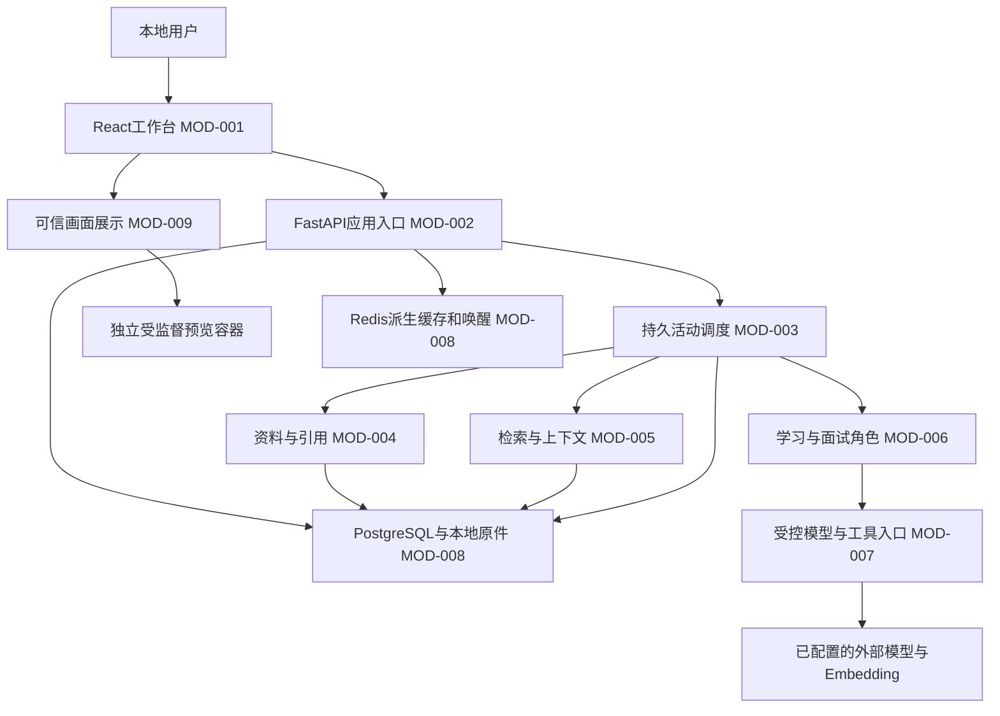

# PROJECT_ARCHITECTURE

### 开发与部署工具交付安排（2026-09-23用户指令，当前有效）
- Git：STEP-002新增工程管理补项TASK-080/R-074，近期执行，历史002工程验收不被重写为失败。已完成仓库/忽略边界及用户确认的599文件本地首提交；未设远端、未推送，后续保持精确范围及敏感排除。后续开发卡必须保护既有差异并记录适用提交/差异/hash。
- Compose：纳入STEP-018服务集成前段，编排在该阶段出完整部署集成卡，不提前创建空配置。计划正式位置deploy/compose.yaml、deploy/.env.example；固定镜像版本/摘要、独立项目名、仅loopback端口、健康检查、持久卷及备份恢复、占用与停止策略。先协调已采用PG/必要Redis，API/worker是否容器化按届时实际监督机制决定；不能把Windows Job监督直接搬到Linux。验收含配置解析、合成数据下启动/就绪/停止/重启持久化及失败定位，不复跑无关业务套件，不接用户库。079一次性合成容器不迁入长期Compose、不改其预算。
- Linux：STEP-018记录平台依赖与适配缺口，STEP-020运行交接必须明确“Windows已验证/Linux未验证”及未来部署前置；完整Linux应用部署属于后续Linux交付批次，目标发行版/宿主/权限明确后再出卡，不扩大首版Windows目标。正式配置预计deploy/linux/；实际验收必须覆盖路径/权限/进程树终止/worker监督及持久化恢复，不能以Linux PG容器运行代替应用兼容通过。
- Nginx：STEP-018按实际静态资源/API/SSE入口判定必要性；需要时在同一集成卡落deploy/nginx/配置并验证代理路由、流式响应、上传限制和入口权限，无此需要则STEP-020记录直接本地入口及不启用理由。Linux部署批次重新评估Nginx或平台等效代理；HTTPS在实际远程入口需要时验证，不为本地loopback先建公网/域名。代理、安全权限或监督边界改变时保留STEP-019独立审计，不以部署配置检查代替。
- STEP-020/08交接引用确切Git版本、部署配置与适用运行证据、密钥注入位置、备份恢复和停止步骤；生产发布/远程修改/安装/服务重启仍需对应执行授权。以上为计划，未生成配置、未安装或运行，编排统一负责届时出卡和验收。
### G3正式关闭，范围修订与成果续接完整实施（2026-09-29，v0.56，当前优先）
088/089批准G3切片经编排最终验收通过关闭，裁定Ndocu/results/TASK-088-089-final-acceptance.md。末批Windows真实链及实际加载hash已补齐，原独立审计无剩余阻断，当前58项post匹配。44离线/18PG复用，不追加审计或运行。范围只含批准G3；真实provider、G4/G5、STEP008整体与发布未通过。
采用TASK-089-next-contract推荐的G4/消费内部闭环，由TASK090/R084完整实施：真实scope CAS与read_scope，锁后来源集合复核；同活动持久父成果→显式不同新操作，重新权威准入，未知不重发、预算不复活。002/007模型不变、不加008/公开HTTP；内部可选引用不发provider，工具集合为空。范围失效不阻断原取消/关闭/结算保守收尾。
090沿原089主执行窗口，实现/相关测试/普通修复同卡连续完成，成果稳定后集中一次隔离增强审计，修复仅增量确认。代码尚未实施，卡待转交。新运行账严格复用指定w1容器、只创建090专用合成库/role，许可精确角色凭据按批核验后轮换，避免旧owner内存丢失形成重复停顿；不继承088/089余量。
088历史越界与旧证据缺陷保留；089所有执行许可已结束，不以余秒再起资源。Compose/Linux/Nginx既定交付阶段保持。
### G3修复/主体证据通过，剩一例最终Windows组合（2026-09-29，v0.55，历史）
089已返回部分成果；编排27项当前hash全符，独立审计确认A1回执配对、A2历史结果身份绑定、A3测试清理三组修复通过；44离线与18真实PG证据适用。真实批19执行/1测试构造失败/exit1保留，页预算分支另离线证明，不把批改成全通过。G3最终关闭仍缺实际加载hash绑定的一例Windows链。
同089/R083收尾01沿原主窗与原隔离审计窗口，一卡完成控制器必要适配、唯一补证、精确收尾与证据增量审计。产品/001—007冻结，不重跑已通过套件。新授权只允许原w1 CID中本任务合成retrolume_task089_synth角色的严格目标核对及凭据轮换、复用既有retrolume_task089_g3库；无新容器/卷/库/角色，不改088管理账户或读旧秘密。
D下一业务闭环设计成果接收：真实范围修订/read_scope-CAS、锁后来源集合复核、持久成果到明确新操作的受控消费。当前未派G4实现；G5工具计数及整体STEP008仍开放，生产provider/用户库/HTTP/UI/部署未授权。D3/085既有验收与部署阶段不变，088偏差历史保留。
### G3候选已回，089完整收尾长任务（2026-09-29，v0.54，历史）
088已实现候选007/正文原子提交/显式确认/read-list/worker协议3/N1，21项post当前匹配，存在PG和Windows原始运行记录；未完成独立审计，不能按“57全过、15/15、2/2”摘要直接签最终通过。编排发现record_denied回执提交状态不符批准合同，独立审查须定级并覆盖实际增量。
TASK089/R083按用户睡前一次转交长任务要求，合并独立初审、批准G3边界内修复、缺证定向复验、隔离独立终审与下一受控业务闭环只读实施合同；新最强主窗口，卡内独立子会话只审不写产品，完成后统一回传。主要模型/权限边界沿087 P1—P5，不实施新G4模型或新产品入口。
088超原1容器/3总批是执行偏差，5容器和5启动按报告登记，pg01原目录缺失、离线与hash绑定及安全inspect留审计分级，不追认超额。089新容器/卷额度0，仅在必要时按卡精确复用088 w1停止资源，新合成库与有限总预算；旧证据保留，不删资源。
功能/证据/合规/资源四类结论分开；085/086和D3原验收保持，G3最终、G4/G5、STEP008整体及真实provider未完成。部署工具交付阶段不变。
### G3变更包已批准，TASK088完整实施待转交（2026-09-28，v0.53，历史）
用户明确“批准”TASK-087-work-decision置顶完整包及P1—P5，模型/接口决定已满足，不再问同项或另开设计轮。正式采用007结果表、record同事务正文/received及提交确认、SUCCEEDED确认持久含义、内3外2回执、失效正文抑制的read/list和N1 one_call claim前早拒绝；实际代码仍为085快照，本节是批准设计，不是已实现。
TASK088/R082沿原085/087最强执行窗口，一卡交付完整实现、必要适配、相关离线/真实合成PG/最小Windows接线和范围内修复，结束后独立增强审计另隔离会话。合同优先采用TASK-087-work-decision P1—P5，特别区分提交异常与既存正文、取消/结算持久事实、非空来源及SQL正文投影，禁止按历史错误方案实施。
资源是088新卡精确预算（1个新合成PG容器、127.0.0.1:55441、离线900秒/真实累计1800秒/至多3批/Windows至多12会话），不是恢复083/085余量；真实provider/用户库/部署/提交推送仍0。083/084、085/086验收保持，G3当前未实施/未独立验收，G4/G5/STEP008整体未闭合，Compose/Linux/Nginx既定阶段不变。
### G3完整批准包已形成（2026-09-28，v0.52，历史：批准前）
087修正轮01已回，24项输入hash核对无漂移；设计成果按“修正轮01报告+TASK-087-work-decision.md置顶覆盖条款”验收通过。后者对响应/历史事实、取消后结算、失效读取SQL、规范化边界与实际返回对象作最终编排收敛，不宣称执行报告原文全无矛盾，不再派设计轮02。
新表activity_operation_results、正文与received同短事务提交、RecordOutcome确认、SUCCEEDED持久含义、worker协议3摘要回执、两个抑制失效正文的读取接口、N1早拒绝构成一个候选变更包，等待用户明确批准，未批准实施。只读设计通过不等于模型已正式采用或功能验证。
外层协议2保持；提交异常不否认既有正文、取消已清R后不重复结算、settle响应丢失按持久事实不再折叠。无scope/来源绑定证据不返回正文。085/086、083/084原验收不变，G4及整体STEP008仍未完成。

### G3首轮合同回收与一次修正（2026-09-28，v0.51，当前优先）
087只读设计首轮已回，17项输入hash核对无漂移；“存活worker的record_outcome短事务原子保存正文与received”作为候选方向采纳，实施合同尚未通过。新表activity_operation_results、SUCCEEDED提交含义、协议3及读取接口均未批准实施。
原087窗口修正轮01合并处理：提交响应丢失与回滚区分、来源/scope失效读取抑制正文、关门/终态幂等资格、正文规范化/hash实际一致、逐跳协议及完整文件清单、原目标验收矩阵缺项。只读设计运行0，不追加测试，不重开085/086或D3。
源码事实勘误：begin_window_close只置dispatch_closed，settle才推进G；_operation_is_current不含dispatch_closed。正文新写门禁须明确设计，旧诊断不变；gateway已有成功正文回传但未持久化。旧文字简写不作为新实现依据。详见TASK-087-work-decision.md与087卡修正轮01。

### 085内部接线正式验收、转G3合同（2026-09-28，v0.50，当前优先）
TASK085受控one_call及TASK086独立增强审计已由编排验收关闭，无阻断补项；裁定Ndocu/results/TASK-085-086-final-acceptance.md。协议2、有界映射/回执、真实租约身份与停止结算接线在批准内部切片范围通过。生产固定入口仅证传递与拒绝出站，成功链使用测试transport，真实供应商未验证。
N1超120秒配置死区是未修的低危问题，当前one_call使用≤120秒且满足窗口余量；后续相关实施安排早拒绝。N2最终限额/帧边界证据保留静态分级，可选补跑不作为验收门。审计的环境变量/unknown_repeat摘要口径已由编排按原始记录纠正，旧报告保留，不重开测试。
G3仍未实现：当前回执not_committed，关闭门推进G后不能作为旧G业务提交权。TASK087/R081只读形成原子业务提交/恢复读取完整实施合同，沿085原最强窗口；涉及正文持久结构/提交语义的候选需先有具体方案再裁定，尚未批准新DDL或产品改动。G4、M-1/STEP008整体及部署计划不变。

### one_call候选回收与独立审计（2026-09-28，v0.49，当前优先）
085已返回：新增one_call及七个worker文件改动，协议2、claim派生身份、有界结果与映射生命周期已作为候选落地。编排核52项当前hash一致、原始12场景start/result/complete、批exit0及精确树/容器收尾记录；不代签新增跨进程秘密/身份/停止安全。
候选入口限制服务请求/响应各64KiB、业务封套128KiB、映射1MiB；生产白名单与仓储/001—006不变。成功组合采用测试自举与transport替身，固定生产入口只验证数据传递及拒绝出站；不代表供应商成功连通。回执not_committed，G3业务原子持久提交/重启读取未实现，M-1/STEP008未完成。
TASK086/R080全新隔离增强审计待转交，只读实际增量与原始证据，明确测试注入/协议兼容/秘密/停止及运行边界。085停止修改/运行，旧D3不重开，费用0。Compose/Linux/Nginx阶段不变。

### STEP006/008受控one_call接线范围（2026-09-28，v0.48，当前优先）
用户要求转向受控业务调用接线。TASK-085/R-079承接新成果，083/084正式关闭保持不变。已出实施卡待转交，尚无085实现/验证结果。
MOD-003/007/008、FLOW-005：固定内部入口传有限请求与受信配置，SUP成功claim后派生G/scope/W_eff交固定worker，经ClosingCallGate与真实gateway/PG账本执行至多一次调用，再有界回传模型结果及独立的监督/结算状态。保留预扣后启动、树零及自有句柄关闭后关门/结算、D3单机单会话与保守恢复语义。新增跨进程数据通道需限长/严格身份与生命周期管理，不开放任意命令或生产endpoint。
这是内部单次调用切片，模型SUCCEEDED不等于业务成果已持久提交或仍有提交资格；G3原子业务写入/幂等读取及G4等既有缺口仍登记，不用临时回执代替，不变更主要持久模型。UI/HTTP/工具自动执行/付费供应商调用未授权，M-1/STEP008整体未关闭。
085同卡完整实现、定向离线/合成PG+Windows验证及普通修复，复用未变D3证据。完成后另安排独立增强审计，不每个普通修正加前置审计。新测试资源与预算独立按卡登记，不恢复083余量；Compose/Linux/Nginx阶段不变。

### D3批准切片正式验收通过（2026-09-27，v0.47，当前优先）
083完整收尾14三文件增量、八场景真实PG/Windows及资源/执行控制经084 review09独立通过，编排关闭083/084批准成果，无阻断补项，见TASK-083-084-final-acceptance.md。单机/单交互会话、单成功恢复链与未触发异常范围保留，不追加D3验证；最近已结算幂等沿旧未变证据，非阻断工具观察按未来实际使用处理。
监督/恢复资产可供接线复用；worker_main.main仍用_UnwiredGateway，one_call缺真实上下文/请求与业务接线。因此M-1/STEP008及产品链未闭合，下一成果转最小受控业务调用闭环，不重复恢复器设计。资源按核验日志停止保留，本任务运行许可结束，不借余预算重启或提交；Compose/Linux/Nginx阶段不变。
### D3八场景真实成果回收（2026-09-27，v0.46，历史）
083完整收尾14已有006空/旧/回滚、有效租约/新G/耗尽/真实锁屏障、真实旧Job→固定SUP新G及PG结算八场景原始通过和精确收尾证据，产品实现本轮未变；三项实际增量集中runner/controller/fixture。已接收待084最终独立验收，不能提前等同审计完成。该链限定批准的单机单交互会话部署，最近已结算幂等沿未变历史证据，异常猝死/跨机/全部恢复交错未由单成功链实证。容器停止保留，剩余额度不自动续跑；M-1/STEP008/产品one_call未完成。
### D3静态门通过、进入受控验证（2026-09-26，v0.45，历史）
review08独立确认修复11八项问题关闭，未变D3主体结论继续有效；产品及运行控制静态条件已具备。真实006完整迁移、claim/锁屏障、旧G Windows恢复与外层嵌套Job仍需实证。编排在原D3批准范围内授权083验证12复用精确停止容器、一次受限认证/新测试口令轮换和完整8场景；不扩大一列模型、单机信任边界、用户库或真实业务接线。猝死悬停孤儿限制和旧证据范围保留，动态通过及M-1/STEP008仍未成立。
### D3修复11候选回收（2026-09-26，v0.44，历史）
锁后主机UTC判断与inspect锁序、旧running账目None/旧树未知清理及测试运行控制均已修改为候选，三批定向离线有原始通过证据；原review07缺陷是否关闭待review08独立增量裁定。新增测试专用外层Job控制/结果契约/runner并不等于真实Windows或PG恢复通过；悬停至Assign崩溃边界及资源复用条件须如实审核。006与单机一列信任合同不变，真实资源继续冻结，无第三容器或用户库授权。既有有效行为按未变依赖复用，D3动态验收、M-1/STEP008/真实接线未完成。
### D3审计阻断与修复裁定（2026-09-25，v0.43，历史）
review07确认D3主体在受信单机单会话条件下静态骨架成立，但P1使用事务起点时间判锁后截止、P2旧树清理未知可能误报完整为确定产品缺陷；代码不通过。修复合同采用锁后主机UTC资格判断并对齐inspect，旧running未确认账目使用None、旧树未知不签清理完整；不改一列持久模型、退款/保守折叠或单机信任边界。R1—R3验证控制及F1夹具同时合并修复；真实PG/Windows恢复仍未验证，已审无关代码和历史证据按范围复用。修复11完成后独立增量核查运行控制再解冻真实资源；没有新容器或用户库操作授权。
### D3候选落地与验证断点（2026-09-25，v0.42，历史）
006/running_owner_session_id、claim原子会话号、SUP可信身份、严格Open错误分类及受部署声明约束的恢复已为候选实现，独立代码审计未完成。claim改DB时间判断租约列入实际控制差异重点审查，不因候选落地默认符合。
离线证据保留；真实PG仅空表006执行及负SID拒绝有局部事实，夹具/runner失败中断，真实claim及Windows旧G恢复未验。两合成容器停止记录保留、额度已用；当前083暂停，084 review07审候选及完整验证链，不追加第三容器。单主机/单交互会话是显式部署信任前提，numeric SID不证明跨主机身份；不扩大用户已批准的一列恢复合同。旧Job07/PG08/09证据按未变依赖复用，M-1/STEP008/真实业务接线均未完成。
### D3恢复增量已批准（2026-09-25，v0.41，历史批准记录）
用户明确批准TASK-083-D3-work-decision：006仅增running_owner_session_id，可信SUP会话号随claim/G原子写入；仅在单机部署前提、匹配会话、精确Job不存在或已证树空、原租约规则及互斥覆盖提交成立时全额折叠。异号/NULL/其他Open错误失败关闭，有效旧租约不得先杀再报冲突。原关闭门/有限幂等/不部分退款不变。实施TASK083完整10卡，尚未实现或验证；一个新合成资源内定向验证/有限修正后独立增量审计。该批准不包含用户库迁移、多主机或真实业务接线。
### 09独立终审后的边界（2026-09-25，v0.40历史）
固定launcher四场景按084 review-06分层证据限定验收通过：正常真实PG闭环、注入的管理截止保守出口、Resume前父死与Resume后父死正常结算。B控制者持Job句柄改变最后句柄条件，不作为生产停止失效证据；C2不证明同链挂死截止。无新确定代码缺陷，旧局部证据复用，不追加全套测试。
D3自动恢复推荐一列running_owner_session_id，须单机部署约束、精确Open错误分类及互斥覆盖DB提交；方案/实施验证范围见Ndocu/results/TASK-083-D3-work-decision.md，状态待用户批准，不是已实现/已验证。未验证one_call及旧G恢复、整体M-1/STEP008继续保留；既有合成容器停止保留，不额外删除。
### 083限定运行证据更新（2026-09-25，v0.39历史）
Job07当前冻结控制器下五个合成场景真实运行exit0，限定Job停止/后代/碰撞/单进程最后句柄行为可用；账本为替身，部分PID/创建时间未完整落盘的证据限制保留。PG08最终专用合成库六例真实运行全部OK：005空表/非空回滚、关闭门与admit/mark、合法outcome、旧G/C受限幂等、锁交错、取消全额折叠与UNKNOWN收敛。取消S=90是账面折叠，不是整树停止证明。原始stderr+exit优先于runner错误摘要。
两次PG前置停批及后续例外授权记录见manifest/执行状态，三个合成容器停止保留；只最终批六例产生业务验证证据，不重置历史。新固定run_supervised_window→SUP真实OS/PG组合尚未覆盖，D3旧G命名空间化身及自动恢复仍开放；本增量不宣布M-1/STEP008完成，不新增字段或平台。
## 当前验证增量（2026-09-23）
时间账本基础切片077结合078独立代码审计、079当前快照22例真实PG及004/约束证据，限定实现已验证；不等于worker监督、M-1或STEP008完成。079失败后重启续跑的执行纪律偏差见执行状态，保留有效业务证据且不重跑。Git本地main仓库已有首提交45951501d2741630a229762d6b2d3f4b34d7f702，599文件与批准manifest逐条一致，无远端/未推送；080已完成本地版本管理准备与首提交，后续提交另按授权范围执行。以下无.git等记述为历史时点。

## 已批准增量：内部单窗监督（2026-09-24，计划中）
用户批准082-work-decision：新增005候选dispatch_closed及begin_window_close，claim新代次开门、admit/mark检查、首次settle需已关门，旧幂等确认不伤新窗；004及既有次数/费用/恢复纪律保留。先claim预扣后启动单窗Job，t0认领前至t1整树退出计入C，Job外可信SUP才可部分退款；C0仅保留仓储合成合同、真实会话禁止免费结算。未知树/响应丢失/超窗失败关闭。具体批准边界见Ndocu/results/TASK-082-work-decision.md，完整实施合同TASK083。
以上均计划中：尚无005/worker新增实现或动态证据。实施窗口由082诊断者转实现者，后续安全审计另新窗口；定向PG另卡，真实模型/HTTP/用户库未接线。独立审计重点包括关门与在途竞态、角色权限、Job身份与最后句柄、跨恢复计费。历史“无worker授权”仅指先前账本批次，不覆盖本次明确批准的内部切片；不扩大到完整产品worker接线。
## 083当前实现增量（2026-09-24，候选/部分验证）
005候选关闭位、repository.begin_window_close/inspect_window及claim/admit/mark/settle门检查已有代码；新增worker/gate.py、worker_main.py、windows_job.py、session.py形成内部候选。repository当前hash929320ba…5b20；005 26b71a83…50eb，迁移未执行/PG未验证。7项离线替身通过仅限调用序；Job初批3/5局部通过且归属不足，场景/命令超时与04清理正证据缺口保留，不能标监督完整已验证。
command_for_lease未独立限时、SUP管理生命周期、finally结果失真、内部门连接和PG可执行测试准备须083离线补足。真实Job额度冻结，原修正已发生但复检未启动；原始失败和字段结果不可被新日志覆盖。按原批准范围继续实现，不接产品外部入口，不宣告M-1/STEP008完成。
## 083离线补足候选快照（2026-09-24）
新增worker/command.py的WorkerCommand与launcher.py的run_supervised_window专用进程入口；session.py结果移至收尾后并区分settled/reserved/pending_fold与未知，gate/worker_main内部关闭链及Job精确控制夹具已补；PG可执行准备在tests/fixtures/task083/pg_close.py、pg_migration.py。代码为候选，final-hashes.txt16文件现场复算相符，不能沿用旧静态或单元日志宣称全部最终代码验证通过。
纯单元初批9/10、失败项修正复检1/1后仍有源码补正，最终动态未验；Job/PG均未恢复运行，原04归属/超时缺口保留。下一TASK084新窗口独立代码与运行控制审查，原实现窗口不得自审；M-1/STEP008仍未完成。
## 084独立审查限制（2026-09-24，当前有效）
关闭门/005主要静态事务有条件通过，真实PG未验；内部监督候选不能放行：launcher启动/IPC/收尾总期限缺口、任意命令可绕过worker门、外层未知树误报清理完成、Job已消失后running/R无法恢复、Job测试控制及PG隔离/并发夹具缺陷。详见TASK084结果D1—D8。083原窗口离线修复，Job/PG持续冻结；D3若需要新增持久证明须具体变更批准，当前单关闭位授权不自动扩大。尚无完整已验证监督或恢复能力。
## 1. 文档信息

- 项目：RetroLume / 溯光教育Agent；文档v0.56；2026-09-29（Asia/Shanghai）；最近关联CHG-0654。记录045行段定位、046受控入口和047PDF组件，完整集成/安全审计仍未完成。
- 当前有效规划—依据用户本轮V3委托，沿用既有需求v1.0目标行为（文档LATER_REQUIREMENTS.MD v1.1）。文档交付不表示产品完成；后续开发已获用户明确授权，按执行文档当前入口接续。
- 唯一架构事实源；原根目录旧文档已移到Ndocu/archives/，只读保留。当前规则由根AGENTS.md映射至外部公共AGENTS/WORK，项目docu旧副本仅历史；流程与文件导航在PROJECT_EXECUTE_STATE.MD，不再双写FLOW/INDEX。
- 项目根D:/shspic/project_NO3_RetroLume-agent；**现有资料切片代码已归入本项目backend/frontend/deploy**；原D:/shuice12/RetroLume只读保留。10项历史hash匹配，两份启动器仅变更配置路径；新路径合成health/静态入口有TASK-043记录，未重跑PG/真实资料。私有配置和数据未复制，模型/学习/面试仍未实现。
- 下文MOD-001/002/004/008、FLOW-001、DATA-001、API-001/004的“已实现”只指资料切片；完整模块未完成。已有范围的行为证据见第12节，不把局部通过升级为全模块“已验证”。其他计划项不因文档写成而改变实现状态。

### 2026-09-14实现增量（优先于下文旧切片描述）

- MOD-004/DATA-002/API-004：materials/locations.py及content可选expected_version/start_line/end_line已实现行段与原换行摘录；100段元数据、500行摘录上限，旧版本明确409。局部后端已验证；前端选择/晚到响应有代码保护，实际浏览器待组合检查。
- MOD-007/API-006/FILE-007：capabilities的ControlledModelGateway已实现并经离线合成响应检查；固定服务URL、工具白名单、总期限、unknown记账，默认账本拒绝，未接真实服务。STEP-008的activities仓储与002迁移已实现，051真实PG合法准入/发送/received路径通过；055补齐七类真实PG反例并通过；完整worker/业务接线与056独立审计尚未完成。
- MOD-004/FILE-004：pdf_import.parse_pdf_bytes已实现Windows Job有界分页提取，pypdf6.17.0/BSD-3-Clause固定本地依赖，成功固定pending_human_review。052已实现pdf_review接口、003候选/逐页确认/补充表、PDF.js6.3.289本地worker/canvas界面；六类契约替身检查与构建通过，真实PG事务/浏览器仍待054。047资源边界已通过050独立代码审计，M-1运行证据绑定并入054组合检查。Job限制不是文件/网络权限沙箱。
- MOD-003/007/008、FLOW-005：051候选按来源→活动→操作锁序实现持久准入；目前应用未接入完整活动/worker。Windows默认运行循环与异步数据库不兼容已由055修正：两个正式启动器使用app.runtime:psycopg_compatible_loop_factory，Uvicorn选择与真实PG已验证；Selector不支持asyncio子进程，后续worker保留同步受监督子进程边界；不改变数据库驱动或用户库。
- MOD-005/DATA-002：retrieval/evidence.py已实现版本、物理页、身份和逐字offset绑定的可复算证据片段与范围先过滤词项候选；流式分片限制2048片/单片2048码点。局部原6例及有界性定向反例通过；无embedding、pgvector持久检索、HTTP权限或完整RAG，后续集成仍须权威来源/活动范围核验。
- HTML B-01仍开放；044只读支持独立容器内可信sandbox子frame候选，无新增页面权限，尚无固定宿主动态结论。

### TASK-058回收后的限定判断（当前有效）

058独立性与原始证据核对有价值，但Work验收为部分通过：准入/发送/结果记账已有局部代码与PG证据，不代表时钟异常、worker或整体权限恢复已通过。原审计保留，事实更正见执行状态，060只读诊断后再形成实施方案。
- TASK-058/M-1：应用墙钟回拨可能延长期限，相关放行仍受限。仅改数据库now/CURRENT_TIMESTAMP不能证明单调期限或跨重启安全；当前不采用该修复建议、不改成功标准。
- L-2本机httpx紧凑JSON与gateway参数一致，原空格差异判断不成立，不据此改transport。002已在合成库执行；用户库迁移和真实应用接线未发生。
- G-1未决操作发现/代次恢复、G-2监督、G-3业务结果原子提交、G-4范围修订、G-5工具计数、G-6可观测性仍为STEP-008及相关接线门槛；不把它们当已实现，也不阻塞独立资料工作。
- 使用合法架构状态与范围描述，不引入“部分实现”新状态；现有“已实现”仅限明确代码片段，整个模块不能标已验证。
### TASK-060事实裁定补充（2026-09-21，CHG-0347）
060只读诊断的L-2、合成库迁移与L-1事实更正被采纳。其事务now在锁等待后仍可自然计入等待的建议与报告自身时钟定义矛盾，不采纳；墙钟回拨不因3600秒配置值而得到真实耗时硬上限。M-1仍为未解决实现缺口，后续与单调监督和跨重启保守恢复一起处理，不改变FLOW-005标准，不增新时间服务。
TASK-062只实现既有准入ID约束与脱敏意外异常诊断，不改公开字段类型、不接线真实模型/账本、不修时钟。相关架构项仍为原局部实现状态，未由出卡变成已验证。TASK-061仅修测试资源归属，不改变产品架构。
### TASK-062局部实现验收（2026-09-21，CHG-0353）
MOD-007/API-006受控入口的CallContext保持字符串及1—128长度：activity_id须可解析为UUID且不改写，operation_id/executor_id受限字符集与仓储一致。意外准入异常返回admission_internal_error、REJECTED且不发送；预期拒绝/不可用维持原码。日志仅记录事件、阶段、随机关联标识和异常类型，不记录异常消息/请求/密钥。
该切片已实现且通过15项限定离线检查，证据Ndocu/evidence/task-062/after-run-utf8.txt及hashes-after-utf8.txt；不是完整MOD-007或STEP006已验证。原046非UUID替身通过口径不适用于新契约；未改transport、预留、时钟、迁移或应用接线。整体独立审计和真实组合要求不变。
061只有测试夹具变化，不改变产品架构；六场景待063单次运行。
### R-061资料切片与后续G-1（2026-09-21，当前有效）
MOD-001/004、FLOW-001、API-001/004中已交付的TXT/MD行段和可提取PDF人工核对切片已验证：065五项及067两项原始运行证据覆盖六类组合，相关18个产品文件hash与当前一致；050组件独立审计与组合环境证据适用。STEP004/005完成，不表示整个模块、全部格式、检索/学习或安全系统已验证。
G-1后续内部仓储扩展状态计划中（TASK068）：list_unresolved_operations为本活动未决项有界游标读取；recover_obsolete_operations仅在既有锁序下把低于当前generation的未决操作置unknown。无DDL/HTTP改变；不退预算不重发、不碰当前代次/终态，列表不是写授权。现有recover_unknown保持原语义；worker接入与M-1仍未实现，不由旧代次收敛替代时间安全。
### R-062 G-1实现候选（2026-09-21）
TASK068在activities/repository.py新增UnresolvedOperation及两个内部仓储方法，并由__init__.py导出类型：G-1该切片状态已实现，尚未验证。有界列表与仅旧代次unknown收敛实际存在，无DDL或HTTP变化；不接worker、不解决M-1。代码独立审计070及修正测试后的真实PG证据仍是关闭此切片的条件。
测试清理外键问题由069处理，不扩成产品schema修改。整体STEP008未完成，不以新增代码替代动态证据。
### R-064内部恢复边界校准（2026-09-21）
070独立只读代码审计提供有限代码层证据，真实PG仍未验证。G-1单批改写上限列计划中（071）：recover_obsolete_operations增加limit默认100、1—200非bool整数；排序锁定本批后仅更新确切ID集合，返回本批数量，不内部循环；无DDL/HTTP变化。上限不等于扫描/排序耗时硬保证。
列表投影包含可构造现有permit的信息，仅供可信且有该活动写权限的内部组件，不能直接暴露给HTTP/工具/模型；空列表不保证活动存在。旧permit仍可写UNKNOWN，须保持锁/终态竞争纪律，不凭generation互斥省去保护。
M-1、worker闭环、动态行为和必要差异审计尚未关闭；不把审计风险推断表述为已发生故障。
### R-065单批恢复实现增量（2026-09-21，优先于R-064计划描述）
G-1的recover_obsolete_operations单批上限现为已实现，未验证：默认100，非bool整数1—200；来源→活动→操作锁序不变，锁定排序候选后，仅对实际锁定ID集合重复活动/状态/旧代次条件UPDATE，返回本批实际改动数。无内部循环、退款、重发或DDL变化。
Work核对当前repository.py hash50ec537b…55cfce6及局部源码；语法检查日志有效，真实PG尚未运行。不能把代码注释的Limit/LockRows计划说明当成已观测执行计划；行数上限不等于扫描/耗时上限。
未来调用方须在次数/总期限内分批并复查，返回0不是永久无未决项证明。070未变部分证据继续适用，变动部分由072独立复核；六个现有PG用例待后续运行。M-1、worker及内部调用权限边界保持开放，STEP008不因此完成。
### R-066差异审计证据（2026-09-21）
TASK072限定代码层审计通过：七项标准无确定缺陷，当前生产/测试hash与审计输入一致；独立性按新会话声明及read_scope记录。071单批切片继续为已实现，动态未验证；不因审计通过升级为已验证。
数组参数适配和六个现有PG用例由073一次定向运行确认；不额外要求EXPLAIN/压力/执行计划证明。并发、M-1、worker、调用方权限等既有适用边界未关闭，不改变锁序、范围或数据模型。
### R-068仓储恢复切片验证完成（2026-09-21，优先于此前未验证描述）
074仅补test01查询投影，生产repository hash仍50ec537b…55cfce6；072代码审计仍适用。六个真实PG用例全部OK/0skip，含分批2/2/1/0、终态/预留和隔离；六表清理为0、容器停止确认。合并068/069/070/071/072/074证据，list_unresolved_operations和recover_obsolete_operations仓储切片状态已验证（上述限定样本与环境）。
关闭该切片的既定真实PG验证条件，不扩大到并发压力、时钟、崩溃或worker。G-1完整调用闭环、M-1及FLOW-005整体仍未完成；073失败记录不改写。075仅形成M-1/worker首段最小方案，尚未授权数据模型候选实施。
### 2026-09-22时间账本基础切片批准增量
用户明确批准TASK-076-work-decision中的时间账本基础切片。DATA-007/FLOW-005内部时间额度部分状态计划中：004仅空activities合成库候选迁移，五列M/R/S/最近结算代次与秒数；预扣、整窗结算S+=C/R-=W、遗留折叠和取消，既有次数/费用不变。
ActivitySpec新增必填M；claim新增window_seconds，ActivityLease带实际预扣窗口，预算耗尽返回None并确保必要折叠关闭已提交；settle为可信内部受限幂等接口，elapsed_seconds向上取整，超额拒绝不钳制。完整契约见TASK077。
无HTTP、worker、监督或用户库接线；字段不表示实际时间已受强制监督。主要模型变更获准，尚未实现/验证。新PG验证与独立审计另卡，按实际依赖处理旧证据，不默认全套重跑。
### R-071时间账本基础实现候选（2026-09-22）
077实际新增004五列候选及claim/settle/cancel时间计数实现，DATA-007该基础切片状态已实现，尚未验证。004未执行；无worker/HTTP/模型接线，不等于M-1解决。
Work复算六文件hash匹配回报；读取compile日志COMPILE_OK 5/exit0及关键事务路径。历史结算两列改用成对NULL表示从未结算，非负约束覆盖等细节交078独立审计，不把候选所有约束视作已审通过。
既有恢复方法主体未计划改动，但其测试夹具依赖claim，072/074证据保留原适用边界，未来按实际影响补证。077报告编辑覆盖事件只有执行者声明，最终hash已核对，不推断原因已解决。
### 2026-09-22 review-02 N1事实纠正
时间账本仍为未验证候选。当前ActivityLease实际缺合同要求的window_seconds字段，而claim成功路径传入第六参数，构造必TypeError；此前报告称字段已实现不能采信。TASK077修正轮02将补字段，尚未执行，成功认领路径不可用；不得以compile记录声称运行通过。D1/D2/O1修正已落地，004 generation非负CHECK存在，PG及必要强档独立门仍未通过。无新增模型/接口方案，仅补齐原批准合同。

### 2026-09-23 N1修正轮02回收（优先于上段未修状态）
ActivityLease已补第六个必填字段window_seconds:int，表示claim实际预扣W_eff；保留前五字段顺序及frozen=True，不是请求窗口或实际耗时测量。repository当前hash045a3cf8b1c81d7a1336c3bd2e90e891e4e53934027c9fea9727fafde7202534；原始单次构造日志支持六参数返回结构局部已验证。未执行真实claim/迁移/PG；时间账本整体仍已实现未验证候选，增强独立审计门保留，无worker/生产退款接线。

### 2026-09-23 TASK078代码复核完成
review02加review03覆盖当前时间账本候选及N1增量，限定代码审计通过，独立性事实接触披露见执行状态。五列/claim/settle/cancel仍为已实现候选，真实PG与004尚未执行；TASK079将按新冻结快照完成空表迁移/非空拒绝/约束及实际依赖用例。此处不将DATA007整体改为已验证，不关闭worker/M-1或生产退款门。

## 2. 依据、目标和取舍

已确认需求：个人Windows本地，通用高中/大学教育；学习闭环优先，文字面试Must。资料→理解/诊断→目标/路径→练习→反馈→交互解释→复测→更新路径压成一条持久主链。所有PDF先人工核对，TXT/MD自动；图片/Office/扫描件和扩展来源Should、语音Could；不含公开服务、多租户、实时语音面试或全学科正确性承诺。

采用自有应用＋少量组件、单体业务＋独立worker、PG权威状态、Redis派生缓存、按需专业角色。代价是自行维护状态迁移/预算/评价；不用微服务和自由递归Agent，不同时引入三套LLM框架。已有技术方向和Redis8/RSALv2、Docker独立预览决定不再要求重复确认。具体HTML边界不因该方向选择而成为已证实事实。

输入：初步需求v0.2内容、最终目标v1.0、调研历史五候选、HYP-001～006与旧局部审计、TASK-038～042产品证据。历史小样本不是产品完整链；HYP-006整体路线停止，B-01只限制HTML及完整MVP。用户问题证据仍主要提出者陈述，无真实学习提升率/人群数据。

原件/证据/学习记录保留至用户删除；外发仅本活动必要片段，显示服务用途；密钥不进入页面/日志/导出。现有代码、资料、备份三目录为先前批准事实，本轮按新规则规划源码归并，不擅移数据/凭据。代码根目前无.git，当前目标根与D:/shspic未见.git目录；不是Git提交或干净检出结论。

### 现状与目标的显式差异

| 类别 | 已核实事实 | 仍需实现/限制 |
| --- | --- | --- |
| 资料切片 | TXT/MD上传、列表、原文、显式替换；原件hash与PG版本事务；历史真实浏览器/PG证据 | 行段级片段、PDF、索引/学习/面试未实现 |
| 状态/数据 | 来源与版本两表、只读原件hash校验 | 活动/预算/记忆/恢复仍计划；原型两表不代替全部数据模型 |
| 工程 | Python/React入口和锁文件存在，12项最终hash本轮一致 | 独立新环境重建/新目录启动仍须在迁移实施后检查；启动器只有历史语法和底层命令证据 |
| HTML | 原实验局部启动/离线修正与有限旧宿主证据 | 新页创建前拒绝B-01开放；完整独立宿主运行与TASK-035审计未完成 |

## 3. 总体结构与模块

浏览器不直接访问数据库或模型。API接收短操作，长解析/模型调用在同一后端代码库的独立worker进程执行；两者共享领域规则而非两套实现。业务状态以PostgreSQL为准，Redis失效可回源恢复；HTML只能显示受限交互，不能调用API工具。模块划分是代码职责，不是九个微服务。

| ID / 状态 | 职责与需求 | 输入→输出 / 依赖方向 | 明确不负责 |
| --- | --- | --- | --- |
| MOD-001 / 已实现 | 工作台：资料核对、学习/面试、证据侧栏、记忆及预算可视；FR-001～012 | 用户动作→API命令，事件→可理解进度；依赖002/009 | 密钥、事实裁决、任务预算授权 |
| MOD-002 / 已实现 | HTTP入口、会话与请求校验、幂等命令；SEC-001/002、NFR-002 | 用户命令→持久命令/返回活动ID；调用003/004/008 | 长任务执行、提示词内权限判断 |
| MOD-003 / 计划中 | 活动状态机、worker任务领取、限额/取消/恢复、合法迁移；NFR-002/003/005 | 活动状态及用户事件→下一合法动作或等待；调用004～008 | 让模型任意改活动/预算、把缓存当进度 |
| MOD-004 / 已实现 | 逐文件导入/解析、核对、版本替换、原件引用回查；FR-001/003/004、DR-001/003 | 原件/确认→版本化片段和引用；依赖008 | 自动证明所有复杂PDF语义正确、OCR/Office首版承诺 |
| MOD-005 / 计划中 | 范围检索、证据包、上下文配额、记忆投影；FR-003/004、NFR-001/005 | 问题/版本范围/活动→有限上下文及候选证据；依赖004/007/008 | 模型自行扩大范围、全历史无限拼接 |
| MOD-006 / 计划中 | 意图、计划、练习、反馈、复测、面试专业角色；FR-002/006～011 | 证据包及任务→结构化建议；依赖005/007 | 自建任务循环、直接数据库写入、把单次正确认定长期掌握 |
| MOD-007 / 已实现 | 模型适配、工具目录、参数/权限/结果校验、费用预留；INT-002/SEC-002 | 获准调用→有效结果/明确失败；依赖003预算及008记录 | 任意shell/Python执行、动态安装MCP、隐式重试 |
| MOD-008 / 已实现 | PostgreSQL/pgvector存储、文件库、派生Redis缓存、导出备份；DR-001～003 | 领域事务/原件→持久事实或副本；被002～007使用 | 教学推理、只靠Redis锁保证一致性 |
| MOD-009 / 计划中 | 受限HTML宿主与展示协议；FR-009/SEC-003 | HTML产物→独立容器画面/有限输入及失败提示；可信监督器控制 | 外部网络、父页数据、文件/系统/模型工具访问 |

## 4. 一条主链与多角色编排

### FLOW-001 / 已实现：资料进入可用范围

002逐文件持久化导入记录→原件写临时文件并完成hash核对/原子落位→004受限解析→保存原始提取与物理页/段/行定位→PDF进入待核对；TXT/MD按支持范围校验后可激活→用户确认/补正或跳过→005建立该版本索引。

文件失败只标该项。替换先保留旧活动版：候选解析失败不影响旧版；新PDF待核对期间明确显示旧版仍在用，禁止把新旧片段合成一版；核对及索引就绪后一次事务切换活动版本并提升范围修订号。旧活动历史可查看，但下一次生成需重建上下文或由用户明确新建历史范围活动，不能偷偷继续用旧版。

人工补正分两类：原文片段重排保留原页映射；纠字/新增解释保存为用户补充版本，不能冒充PDF原文。无可信位置的原文引用拒绝。重启时未完成临时件可定位恢复，不以缺少DB记录自动删除文件。坏格式、过大、加密/扫描无可提取文本显示具体原因及替换/跳过入口。

### FLOW-002 / 计划中：统一学习与面试活动

一次持久活动 = 范围快照 + 目标 + 模式 + 已确认记录 + 预算。主流程：意图/范围检查→必要追问→检索证据→生成当前教学或面试动作→校验→事务保存→展示/等待用户→收到回答→反馈→必要复测/追问→保存更新理由。学习/面试只是在动作类型和评价维度上分支，共用状态、证据、预算和恢复。

专业角色采用同一个模型服务上的独立提示与结构化输出：意图/计划角色、出题/面试角色、评价/复测角色、HTML解释角色。检索和权限检查是确定性服务。角色按需执行，不要求每轮调用全部角色；默认无角色间自由聊天或递归委派，不为“多Agent”额外开独立进程。只有不同独立资料的导入可有限并行；同一活动只允许一个有效执行代次。

动作输出含所依据的证据ID、回答/作答版本、可观察判断、原因假设、下一活动理由。003验证动作是否属于当前合法阶段，007验证格式/来源/数值及权限，006无法直接提升掌握或写业务状态。数学核算使用有限表达式运算工具而非eval/任意代码；开放回答用评价维度和证据，分离正确部分、缺证据部分及未知原因。自动语义评审不能保证正确，用户可修正且保留历史。

### FLOW-003 / 计划中：检索与证据链

1. 先按活动范围、可用/未删除版本、PDF核对状态过滤，再检索。查询与答案文本是资料，不是控制指令。
2. 首版pgvector精确余弦检索与本地词项通道融合：中文用规范化字符片段/词项匹配基线，英文词项匹配，均保留原文位置；不假定PostgreSQL默认分词能解决中文。合并采用排名融合及同源去重；参数在阶段06用中英代表样例冻结。
3. 保留可定位的页/段结构，长片段切分附原位置区间，邻近扩展不能跨版本/来源；表格/复杂布局不自动线性推断，沿人工核对后的内容。
4. Embedding负责文本→向量；pgvector负责存储/距离，不替代模型。索引带供应商、模型标识、维度、规范化及切分版本；查询与索引必须同一配置，拒绝混用。建议先沿已测embedding-3/512维作候选，不宣称正式配置已批准。
5. 明确领域的问题过滤到该范围；Spring等歧义保留两侧来源并追问。缺证据和来源冲突是结果，不反复检索直到模型编出答案；扩展源只在Should获准启用后作为独立有许可来源加入。
6. 上下文证据包由应用分配不透明证据ID，映射至原件hash/版本/位置或活动作答版本。输出引用必须为本次允许集合，服务器重新校验存活状态和版本。面试自报标“用户自报”，计算结果含输入、运算、结果/工具版本；模型不能创造来源ID或把引用存在当语义支持。

代价：精确检索及简单词项基线规模受限、中文语义有漏召回；达到容量/召回实测门槛再评HNSW、专用分词或reranker，不现在增加服务。外部Embedding不可用时可以明确切到词项模式，但显示检索能力受限，禁止假称向量检索成功。

### FLOW-004 / 计划中：上下文与记忆

上下文按优先级装配：系统规则/输出协议→当前目标与范围→当前问题/作答→本轮证据→必要最近轮次→相关学习记忆；为回答、工具往返和协议保留空间。按当前模型输入上限估算token，超限先删无关历史/缩减召回，仍不足则拆分任务或追问，不截断关键来源。输入容量和输出额度分开配置，不能拿实验2000token作所有角色固定值。

三层记忆：不可变事件与原始证据为事实；用户可编辑的目标/偏好/学习记录为版本化数据；摘要/检索索引/熟练度投影为可重建派生物。摘要附来源事件集合、范围修订号和不确定性，不能把“可能”压缩成事实；更新/删除使派生上下文失效。模型建议更新记忆经应用校验落库，显著能力结论保留依据及用户修正入口。恢复从持久记录重建，不把模型上下文或Redis当唯一历史。

### FLOW-005 / 计划中：有界运行、取消和恢复

活动级累计预算和单次请求预算分开：有限模型请求/工具调用/内部步骤/重试/耗时/费用；每次出站先事务性占次数和费用预留。模型thinking、max_tokens、超时显式配置，关闭SDK隐藏重试；输出上限按角色负载确定，默认无静默抬限。人工等待状态不运行worker；活动执行时间累计与每次绝对截止分别持久化，重启不能重置剩余额度。

worker从数据库领取任务并取得租约/递增执行代次；网络调用不持长事务。每次结果写入检查活动状态、范围修订号、执行代次和唯一操作键；过期worker的晚到结果保留诊断但不能提交成功状态。API短事务可取消活动、递增代次，worker监督器实际结束其自有子进程/容器工作；不能只在页面显示取消。

请求账语义为预留→已发送→收到结果→提交成功，结果未知为单独终态。发送前崩溃无法确定有无发出时保守未知，预留不自动退还；发送后超时/取消/重启不自动再发同一操作。已完成操作可重放持久结果，不重新计分。重新尝试必须形成明确新操作且重新检查原活动剩余额度。外部服务不保证取消或幂等，绝不承诺端到端exactly-once；本地业务提交以事务/幂等保证。

PostgreSQL保存任务/事件/预算；同一事务写任务待办及活动变化，worker轮询领取，不依赖Redis通知可靠投递。Redis只是低延迟提示。DB不可用时拒绝启动有副作用/付费动作；恢复后未知项先对账。系统时钟回拨不得增加剩余时间，活跃进程用单调时钟监督；跨重启以持久预算/截止保守恢复。

### FLOW-005补充：原子准入与版本撤销（TASK-029审计修正）

每次模型、Embedding及有副作用工具调用只经007唯一准入入口。准入短事务按“来源ID排序→活动ID→操作ID”固定锁顺序，同时核查共享来源代次/撤销状态、活动范围修订、当前执行代次/租约/取消状态、权限及全部剩余限额，唯一占用发送资格并预留预算。资格与操作键及执行者绑定且一次性，不以Redis或进程内缓存替代；过期worker不能取得下一发送资格。来源撤销/切换、取消、准入和结果提交使用同一锁/CAS冲突约束；结果校验与成功写入在同一事务内完成，不能被撤销穿插。多来源全量锁依同一顺序，避免交叉死锁。

共享来源代次对所有活动立即生效，不要求同步遍历完所有活动才失效；范围快照含每个来源代次。缓存/摘要即使尚未物理删除也因代次不匹配拒绝使用。删除之前完成的成果可以历史展示，但被删正文/引用必须隐藏或不可用。并发源新增/移除改变范围修订号，同样参与上述提交检查。

准入提交是不可逆出站尝试的逻辑分界，不是数据库与网络原子提交。取消先于准入则不得发出；已准入操作可能已在途或尚未真正发出，取消只能尝试强制停止自有执行单元，不能承诺撤回远端。执行者失联后发送资格不可被其他代次重新领取，该操作保守未知、预留保留，不能猜测尚未发出而自动重发。独立监督器负责租约过期/取消/期限到达时终止自有执行单元；DB不可用或监督失联时不允许开始下一动作。上述设计需实际并发/崩溃测试，不宣称已实现。

### FLOW-006 / 计划中：HTML解释（v0.2替代原iframe候选）

生成以有限证据与交互目标为输入→输出解析/大小检查→独立Docker预览容器内运行非root Chromium/Playwright可信宿主→输出画面及有限交互响应→工作台展示。生成HTML不在主工作台浏览器执行；原iframe直接执行路线被替代，MOD-009职责不变，增加独立执行边界而非新增产品功能。候选Playwright1.62.1及实验镜像已有局部启动证据，完整产品宿主未实现/未通过；精确策略与证据沿SPIKE-017保留，不以旧iframe证据代替。

容器network=none、无开放端口、无宿主目录挂载、无Docker socket/应用凭据/原件/数据库连接，只接受本次已批准HTML和必要内嵌资源；非root、只读根文件系统、受限临时空间、CPU/内存/PID限制，浏览器sandbox保留。外部网络由容器网络边界阻断，浏览器宿主同时默认拒绝全部导航/新页/下载及HTTP/WebSocket等网络通道，仅允许在已创建空白文档注入本次内容；不允许file导航或任意文件读取工具。容器内公共运行时文件仍是进程运行所需，不等于允许读取宿主资料。若具体浏览器不能强制这些限制，该候选不得部署，保持关口阻塞而非以静态筛查替代。

可信宿主与外部监督器使用受限进程管道传递画面和点击/按键等有限输入，主页面不加载原HTML，也不暴露任意CDP/脚本/文件/工具接口。输入验证绑定预览ID、视口坐标和有限键值，画面输出限制大小/速率；生成内容即使伪造控制台消息也不能变成协议命令。没有业务工具桥或模型回调。数学/图形正常输入、边界值及自身导航/file/HTTP/WebSocket/下载/无限循环同时列入后续验证。

容器外可信监督器持有本次专用容器ID和绝对截止，超限/取消/浏览器失联时通过受控Docker接口停止并确认该容器结束，监督器不在HTML的执行线程/容器内；不能全局杀浏览器或删除其他容器。监督器失联由外层运行控制器发现并停止该专用容器，不允许无监督启动。工作台只是显示画面，HTML无限循环不影响停止按钮的运行主体。此路线代价是Docker运行/画面交互开销及可访问性适配，尚未实际验证；不把008 iframe结果移植为新宿主通过。独立Docker方向已确认；B-01具体创建前拒绝尚未证明，当前不启用预览、不扩大权限。

### FLOW-007 / 计划中：删除、导出与恢复

用户删除先提交可见的逻辑撤销与范围修订，立即停止相关生成/检索及缓存使用，再按精确清单清理活动数据与派生索引；原件和备份删除说明影响并按授权执行，不自动递归清目录。引用保留不含被删内容的不可用标记；用户补充/记忆删除同步撤销派生摘要。已出站片段不能保证从供应商撤回，按实际条款说明。

导出包含原件、来源版本、证据/修正关联、关键活动/作答/路径与格式版本清单；不含密钥，已删除内容不意外导出。备份在应用暂停写入/排空任务后，记录数据库快照和文件hash清单，保持两者一致；先在独立目录/数据库副本恢复验证，不覆盖原库。SQL转储不是完整原件备份；向量可重建但需保留模型/版本配置。备份保留策略由用户明确配置，不默认为自动删除。

## 5. 概念数据与生命周期

下列为总体数据职责；DATA-001的来源/版本子集已有两表，其他实体仍计划中。本轮不建表，已实现不表示全部生命周期已验证。PostgreSQL权威保存元数据/状态，原件存本机选定数据目录；敏感等级按用户资料处理，日志默认不含正文。

| ID / 状态 | 内容、生命周期和不变量 | 访问方 / 需求 |
| --- | --- | --- |
| DATA-001 / 已实现 | 来源与不可变版本：原件hash、来源类型、提取器/修正版本、核对记录、活动版；失败候选不得覆盖当前版 | 004/008，DR-001/FR-001 |
| DATA-002 / 已实现 | 证据片段与引用：位置/摘录/所属版本；原文、用户补充、自报、计算分别标识；删除后拒回正文 | 004/005/006，NFR-001/FR-004 |
| DATA-003 / 计划中 | 派生检索索引：向量/词项、源版本及Embedding配置；仅就绪活动版可检索，换模型重建后切换 | 005/008，FR-003/004 |
| DATA-004 / 计划中 | 活动与范围快照：模式/目标/当前阶段/修订号；用户等待不占执行进程，源变更触发重装配 | 002/003/006，FR-002/006/011 |
| DATA-005 / 计划中 | 作答、反馈、复测和路径事件：操作键、证据链和原因假设；重复命令不重复计分 | 003/006，FR-007/008/010/011 |
| DATA-006 / 计划中 | 记忆与摘要投影：用户可修正/删除，依赖事件/范围版本；失效后可重建，不覆盖原始事件 | 005/008，DR-002/NFR-005 |
| DATA-007 / 计划中 | 任务/调用账：租约/执行代次、预算/预留/用量、请求指纹、终态；未知不重发，预留跨恢复保留 | 003/007/008，NFR-002/003 |
| DATA-008 / 计划中 | HTML产物：输入证据、生成配置、内容hash及验证状态；产物是不可执行于服务器的资料 | 006/009，FR-009/SEC-003 |
| DATA-009 / 计划中 | 配置、授权和备份清单：供应商/用途/限额、敏感密钥外置引用、许可版本、导出清单；日志不复制密钥 | 002/007/008，SEC-001/INT-002 |

关键关系：001拥有002与003；004引用范围版本；005属于004并引用002，006从005投影；007只允许当前004代次提交005；008关联002/005。删除、替换、输出提交必须重查这些关系。数据库事务和文件原子写不能成为跨资源分布式事务，导入状态记录负责发现/恢复未完成落位，不能假称两者天然原子。

## 6. 逻辑接口与计划文件

REST为浏览器到本地应用协议，进度建议SSE，断线后按持久事件游标补读，不重发用户命令。以下只定义职责和必要语义；未实现部分的URL/Schema在相应任务细化；API-001/004当前资料子集已有实际接口，见第12节。

| ID / 状态 | 调用方→提供方 / 内容 | 权限、幂等及失败 |
| --- | --- | --- |
| API-001 / 已实现 | 001→002/004：导入、核对、补正、替换、跳过、删除 | 当前本地会话、版本绑定确认；请求大小/格式校验，返回逐文件状态和操作键 |
| API-002 / 计划中 | 001→002/003：开始活动、回答、修正目标、取消/恢复 | 明确活动版本/幂等键；冲突不覆盖，取消可见且不启动新调用 |
| API-003 / 计划中 | 001→002：活动进度/历史事件 | 只读、有游标，过期游标回快照；SSE断开不取消或重做业务 |
| API-004 / 已实现 | 001/005→004：来源、引用及历史版本回查 | 检查来源访问与删除状态；找不到返回不可用，不转任意文件路径 |
| API-005 / 计划中 | 001→002/008：记忆修正、导出、备份/恢复配置 | 修改显示影响，恢复副本先验；不暴露服务器任意路径读写 |
| API-006 / 已实现 | 006→007：内部模型/工具调用 | 只由003授权，上下文与工具白名单、预算预留、输入输出Schema；无直接外部客户端调用 |
| API-007 / 计划中 | 001→009：HTML产物加载及展示事件 | 原始产物不在应用可信源执行；消息仅展示、不能调用API-006 |

路径相对D:/shspic/project_NO3_RetroLume-agent；现有资料源码已由STEP-024归入同名路径，未实现的模块仍为计划路径；资料/备份按已授权外部数据配置保留。

| ID / 状态 | 计划路径 | 用途 / 输入输出 / 需求 |
| --- | --- | --- |
| FILE-001 / 已实现 | frontend/src/ | React工作台及证据/预算/PDF核对界面；API状态→用户操作；MOD-001 |
| FILE-002 / 已实现 | backend/app/main.py及backend/app/materials/api.py；未来按需要拆分api目录 | FastAPI与Pydantic请求/响应；HTTP→业务命令；MOD-002 |
| FILE-003 / 已实现 | backend/app/activities/ | 准入/租约/预算/恢复仓储局部实现；完整主链状态迁移/worker仍计划中；MOD-003 |
| FILE-004 / 已实现 | backend/app/materials/ | 解析/核对/版本/原文回查；原件→证据；MOD-004 |
| FILE-005 / 已实现 | backend/app/retrieval/ | 证据片段/词项候选纯函数已实现；向量/上下文/记忆装配仍计划中；MOD-005 |
| FILE-006 / 计划中 | backend/app/education/ | 学习/面试角色及版本化提示模板；证据→建议；MOD-006 |
| FILE-007 / 已实现 | backend/app/capabilities/ | 受控gateway/工具Schema/权限局部实现；真实供应商/Embedding集成待做；MOD-007 |
| FILE-008 / 已实现 | backend/app/storage/ 与 backend/migrations/ | PostgreSQL事务、文件库及迁移；领域记录→可恢复存储；MOD-008 |
| FILE-009 / 计划中 | backend/app/worker/ | DB领取/租约、受限执行及监督；任务→持久结果；MOD-003 |
| FILE-010 / 计划中 | frontend/src/explanations/ 与 backend/app/preview/ | 可信画面客户端、独立预览宿主与监督协议；产物→受限交互；MOD-009 |
| FILE-011 / 已实现 | tests/ | 单元/集成/浏览器/故障/离线语义样例；冻结预期→证据；NFR-004 |
| FILE-012 / 已实现 | deploy/ 与 config/ | 本地启动、环境模板、容量/预算默认值与备份说明；无真实密钥；CON-002 |

## 7. 技术与依赖候选

下列区分已安装工程组合和未引入组件。本轮未安装/下载/调用；已有锁文件及TASK-038/041记录定义当前安装，剩余组件采用前核对固定版/许可。链接为历史调研来源，不当成今日最新或完整安全/法律审计。

| 组件 | 用途与版本约束 / 证据 | 许可、成本及替换 |
| --- | --- | --- |
| Python / FastAPI / Pydantic | 已装工程Python3.12.10、FastAPI0.141.1/Pydantic2.13.5/Uvicorn0.52.4；锁文件为准，本轮不升级 | FastAPI/Pydantic根MIT，保留许可声明；其传递依赖另核对。[FastAPI](https://github.com/fastapi/fastapi/blob/master/LICENSE)、[Pydantic](https://github.com/pydantic/pydantic/blob/main/LICENSE)。API/领域分离降低框架替换成本 |
| React / TypeScript | 已装React/react-dom19.3.0、TypeScript7.0.2、Vite8.3.0；Node24.15.0/npm11.17.0。无Next.js服务 | React根MIT，源码/打包依赖分别检查。[React许可](https://github.com/react/react/blob/main/LICENSE)。前端构建、PDF预览组件与浏览器兼容仍需确认 |
| PostgreSQL / pgvector | 已采用pgvector/pgvector:0.8.6-pg17-bookworm；镜像ID sha256:cf134a767f474095eeba57e0117be8e568e011a63f33fbf252f14c9b760f8e6f；psycopg/binary3.3.5。资料关系表已用；产品向量检索尚未实现 | [PG许可](https://www.postgresql.org/about/licence/)及[pgvector固定版许可](https://github.com/pgvector/pgvector/blob/v0.8.6/LICENSE)要求保留声明，无需引入独立向量服务。退出需导出关系/原件/索引配置 |
| pypdf | 已测6.17.0作为文字PDF解析候选；不承担OCR/自动复杂布局；原PDF预览使用浏览器支持能力先评估，不能承诺跨浏览器一致 | [固定许可](https://github.com/py-pdf/pypdf/blob/6.17.0/LICENSE) BSD-3-Clause；保留声明及免责，不使用作者背书。需核查正式补丁版本，替换保留统一页/版本证据 |
| Redis | 用户选型，建议8.x独立本地缓存服务，仅短期派生片段/唤醒，不存密钥或唯一状态；精确补丁版及许可选项待确认 | Redis8提供RSALv2/SSPLv1/AGPLv3选择，不能默认仍是BSD。[官方发行说明](https://redis.io/docs/latest/operate/oss_and_stack/stack-with-enterprise/release-notes/redisce/redisos-8.0-release-notes/)、[8.0许可原文](https://github.com/redis/redis/blob/8.0/LICENSE.txt)。用户已接受Redis8/RSALv2个人本地方向；正式缓存服务未引入，补丁及实际分发范围采用前核查。缓存可关闭回DB，换其他产品须另批准 |
| DeepSeek / embedding-3 | 用户已有API；Flash为首选候选，显式thinking及输出配置；embedding-3/512是已测候选，GLM聊天不承诺备援 | 外部服务不是开源库许可；条款、账户适用性、模型/费用以正式配置核实为准。服务端适配隔离，换Embedding需重建索引；当前无可新增付费实验预算 |
| LangChain/LangGraph/LlamaIndex | 首版建议不用三套叠加：有限主链用应用显式状态迁移+PG任务，模型/检索薄适配。用户已允许按需选择；分支复杂且需可视化时优先重评LangGraph | 放弃现成图编排的代价是需要维护有限状态迁移及故障测试；不构建通用workflow平台。LangGraph回放/中断也不替代外部副作用账。[官方中断说明](https://docs.langchain.com/oss/python/langgraph/interrupts) |
| MCP / function calling | 工具统一白名单入口；内置检索、原件回查、有限计算直接函数调用。MCP仅当实际获准工具需要时加适配，首版不暴露公共MCP服务 | 不能模型发现即安装/调用；具体SDK/服务许可证、权限和数据外发逐项核实，不为技术清单运行额外服务 |
| Docker / Nginx / Linux | 本地DB/Redis建议Docker，API/worker初期Windows本机以便文件核对与停止监督；Nginx仅以后统一静态/SSE代理确有需要时启用，Linux是未来部署目标 | Docker Desktop使用条款和镜像内组件分开核对，实验安装不授权产品分发；不启动公开端口。Windows Job与Linux容器/cgroup终止分别验证，不声称跨平台一致 |

DeepTutor固定v1.6.4 / 93df3d48b70586c36b20ebf82c613a67ed20677f仅参考学习/工具/HTML思路；不直接合入其SQLite/FAISS/评分实现或完整依赖。根Apache-2.0不能覆盖PyMuPDF等不同许可依赖，沿原报告风险保留。产品代码若引用片段须记录许可/来源，实验代码默认重写。

## 8. 质量、部署与验证

本地网络：只监听loopback；DB/Redis不向局域网暴露。浏览器请求需本地会话/随机启动凭证、Origin/Host限制及CSRF策略，不能仅以localhost为鉴权；WebSocket/SSE同样检查。文件路径由应用ID映射，不接受任意绝对路径；上传限大小/页数/时限，不执行宏/脚本；导出引用URL不变成SSRF通道。开发日志默认只记录ID/hash、错误类型/状态、耗时、模型、token/预留、追踪ID，敏感正文仅用户明确启用脱敏诊断副本时保存。

工具/HTML/资料是不同信任域。资料中的“忽略规则/发送密钥”不能变成系统指令；工具参数经白名单Schema验证并与活动授权比对，模型可建议不能自行批准。正式本机数据访问继承OS权限，不承诺能抵御同账户恶意程序。模型输出持久成功前做引用/版本/Schema检查；失败可显示可理解原因，任何修复调用仍计入活动预算。

观测：沿activity/operation/source版本贯穿API、worker、检索、模型及产物；记录状态转换/实际调用/预算预留与实际用量区别。用户看到“哪份资料失败、是否已发送、能否继续”，不要求读堆栈。DB状态轮询为真实状态，Redis和SSE只能加速显示。

运行/升级：不新增长期后台服务。本阶段只设计启动/停止顺序：存储健康→API/worker→本地浏览器；停止先拒新任务、停止自有执行、标未知、再关闭服务。版本升级前保留可验证备份与配置/镜像指纹；数据库迁移先副本验证；不兼容迁移回滚需恢复旧应用+匹配快照，不能只降应用包。已装镜像与锁文件保留；新增组件或实质变更在对应开发卡核查。

测试层次：纯状态/预算/引用校验→真实PostgreSQL/pgvector事务与文件恢复→模型适配契约（合成mock）→获准实际服务的有限样本→真实浏览器PDF/HTML与完整学习/面试主链。复用旧样本作为回归输入，重新验证产品实现；不得只用与实现同构断言。安全/一致性设计与实现按RISK做隔离审计，测试不能由静态阅读替代。性能/预算/样本在相关实现或测试卡派发前冻结；本次只安排时机，不虚构吞吐或质量百分比。

## 9. 需求追踪矩阵

| 需求 | 架构承载 | 计划验证 |
| --- | --- | --- |
| OBJ-001 | MOD-001～005/008，FLOW-001/003/004 | 资料→引用→恢复连续性 |
| OBJ-002 | MOD-003/006/009，FLOW-002/006 | 学习全链及复测理由 |
| OBJ-003 | MOD-001/006，FLOW-002 | 不限领域的活动范围与文字面试正反例 |
| FR-001 | MOD-004，FLOW-001，API-001 | 普通/复杂/坏PDF、核对/补正/替换/跳过 |
| FR-002 | MOD-003/006，FLOW-002 | 意图可修正/缺目标/歧义追问 |
| FR-003 | MOD-004/005/008，DATA-001/003/004 | 活动范围过滤、版本切换及重开 |
| FR-004 | MOD-004～007，FLOW-003 | 引用位置与支持性、缺证据/冲突/核算 |
| FR-005 | MOD-004/005（仅Should纳入时），FLOW-003 | 获准来源许可/版本/适用性；当前未实现 |
| FR-006 | MOD-006，FLOW-002，DATA-004/005 | 路径关联目标和实际诊断理由 |
| FR-007 | MOD-006/007，FLOW-002 | 题目/答案/解释依据与多类任务 |
| FR-008 | MOD-006，DATA-005 | 单位/否定/等价/程序推理、归因正反例 |
| FR-009 | MOD-009，FLOW-006，DATA-008 | 正常交互/边界计算/非法权限 |
| FR-010 | MOD-003/006，DATA-005/006 | 复测→更新/保留理由→恢复，重复不计分 |
| FR-011 | MOD-006，FLOW-002，API-002 | 提问/回答/追问/反馈，有据与缺证据样例 |
| FR-012 | MOD-001/002，API-002/003 | 文字渠道完整；可选渠道不扩为Must |
| NFR-001 | DATA-001/002/005，FLOW-003 | 全链引用与历史作答版本回查 |
| NFR-002 | MOD-003/004，FLOW-001/005 | 坏文件/超时/取消/恢复/晚到反例 |
| NFR-003 | MOD-003/007，DATA-007 | 时间/次数/工具/费用上限实际生效，跨恢复累计 |
| NFR-004 | FILE-011，全部FLOW | 冻结样本/阈值与逐环节真实验证 |
| NFR-005 | MOD-003/005，FLOW-004/005 | 摘要失效、记忆修正删除、状态恢复 |
| DR-001 | DATA-001/002，FLOW-001/003 | 原件/补正/历史版本可辨 |
| DR-002 | DATA-004～006，FLOW-007 | 保留/修正/导出/删除及独立解读 |
| DR-003 | MOD-004/008，FLOW-001/005/007 | 失败替换保旧、成功切换、恢复不抹成果 |
| INT-001 | MOD-004/005（Should），DATA-001 | 纳入外部来源时检查许可和证据 |
| INT-002 | MOD-007，API-006 | 真实能力/端点/错误契约与费用，无隐式重试 |
| SEC-001 | MOD-002/007/008，DATA-009 | 外传最小片段、密钥/日志/删除边界 |
| SEC-002 | MOD-003/007，FLOW-005 | 注入/越权/陈旧代次/真实停止与隔离审计 |
| SEC-003 | MOD-009，FLOW-006 | 宿主动态权限反例与独立审计 |
| CON-001 | MOD-005/006，FLOW-003 | 范围/规范/计算冲突明确呈现 |
| CON-002 | 第7节、FILE-001～012 | 用户技术方向与最少依赖、目标环境兼容 |
| CON-003 | 第2节 | 已取消日期约束保留，不生成截止日期 |

## 10. ADR与风险

| ID / 状态 | 推荐决定 / 依据 | 主要代价、放弃方案与重评条件 |
| --- | --- | --- |
| ADR-001 / 计划中 | 单体业务+独立worker，共用PG权威状态；覆盖NFR-005 | 放弃微服务/多套Agent状态；需维护明确边界，单用户规模变为多人高并发再评 |
| ADR-002 / 计划中 | 有限持久状态机+按需专业角色，无自由递归Agent；FR-006～011 | 应用维护迁移/恢复，暂不用LangGraph；复杂分支收益超过新依赖/回放成本再评 |
| ADR-003 / 计划中 | PG精确向量+词项融合、版本先过滤，Embedding单一配置；FR-004 | 中文基线和规模受限；召回/延迟实测不足再加索引/分词/reranker |
| ADR-004 / 计划中 | 所有PDF人工核对且原件/补正版本分离；FR-001/DR-001 | 用户多核对一步；无自动复杂检测承诺，未来可靠解析取证后变更需求 |
| ADR-005 / 计划中 | 预算/任务事务保留，未知不自动重发，Redis仅派生；NFR-003 | 模糊失败可能需要人工重新选择操作，牺牲自动重试便利；服务幂等可核实后才放宽 |
| ADR-006 / 计划中 | HTML无业务工具桥、隔离宿主；SEC-003 | 不能直接联网或操作应用，任意第三方页面需改适配；新增权限先改需求审计 |
| ADR-007 / 计划中 | 原件文件库+PG关系/状态，索引/摘要派生；DR-001/002 | 两存储备份必须一致；不先引对象存储，设备/部署改变时重评 |
| ADR-008 / 计划中 | Redis8独立服务按已确认RSALv2个人本地使用；具体补丁版待核查；CON-002 | 不默认承担分发/网络义务，也不擅换Valkey；结果影响组件批准，不改变主链 |

| ID / 状态 | 风险、证据与影响 | 缓解/验证及关闭条件 |
| --- | --- | --- |
| RISK-001 / 待确认 | 原件替换/删除与生成并发，陈旧证据污染；旧局部样本不覆盖完整产品 | 范围修订/提交时校验+事务；设计独立审计与产品并发反例通过前保留 |
| RISK-002 / 待确认 | 远端已收费但本地未知，重试会重复费用；012/014只支持局部恢复 | 预留/唯一键/执行代次/未知不重发，真实服务不假称可取消；独立审计及故障矩阵 |
| RISK-003 / 待确认 | 小样本语义成功不能保证通用错误归因和引用支持 | 冻结多类正反例、用户修正、缺证据兜底；长期效果仍需本人试用 |
| RISK-004 / 待确认 | HTML同浏览器CPU阻滞、隔离策略/消息桥绕过；008不是新宿主验证 | 已改为独立受监督Docker预览候选；无主页面执行/权限桥。网络none仍有容器回环，禁止内部监听服务；导航/file限制及画面交互尚需最小验证与审计，不先宣称可控 |
| RISK-005 / 待确认 | 具体Redis许可/依赖版本/真实API条款尚未锁定 | 第7/12节对应组件实施前检查，真实资料外发前核条款；核心不可接受才提出范围内替换或用户变更 |
| RISK-006 / 待确认 | 中文词项漏召回/重建向量时混空间 | 配置隔离、双版本索引就绪后切换、正反例评估；不可混用版本 |
| RISK-007 / 待确认 | 文件库/数据库备份不一致及删除后副本残留 | 暂停写入快照/清单hash/副本恢复，删除明确备份影响；不承诺不可恢复擦除 |

## 11. 修改影响与维护

输入格式变化核对MOD-004、DATA-001/002、FLOW-001、API-001及FR-001优先级；模型/Embedding变化核对MOD-005/007、DATA-003/007、预算和许可；活动/评分变化核对003/006及004～006数据与FR-006～011；权限/HTML变化核对007/009及SEC、FLOW-005/006，须另批准和独立审计；数据删除/迁移变化核对008、FLOW-007及DR；部署变化核对执行监督、来源隔离和第7/8节。

架构项状态只用计划中/已实现/已验证/待确认/已废弃。批准设计不自动变为已实现；实现必须有实际路径，已验证必须有相应证据。每次变化保留ID并更新本文件/CHANGE，未来STEP/TASK引用本文ID。废弃保留替代映射；不复制出另一架构文件。需求变化先走需求批准，不能用本文偷偷改变v1.0。

## 12. 实际代码地图与后续入口

以下实际代码位置现以本项目为根；原D:/shuice12/RetroLume保留历史。TASK-043归并后Astra复算12项hash，10一致、2启动器有配置差异；历史PG/浏览器证据仍仅覆盖原资料切片，不把实验目录视作正式实现。

| 架构项/实际文件 | 已核实入口和调用关系 | 副作用、异常与已验证边界 |
| --- | --- | --- |
| FILE-002：backend/app/main.py | Settings、load_settings、create_app；加载OriginalStore、PostgresMaterials及materials.router，挂载前端静态资产 | 创建原件目录，要求资料/备份绝对独立路径；缺配置拒绝；Host和API no-store边界。文件顶部“仅就绪检查”注释已过时，按代码事实记录，未在文档任务修改代码 |
| FILE-004：backend/app/materials/api.py | local_request、repository、valid_id；GET /api/session，GET/POST /api/materials，GET /api/materials/{source_id}/content | 本地会话/来源校验；上传调用原件存储再调用PG；5MiB、UTF-8、30秒接收，失败按文件返回；不是任意文件读写接口 |
| FILE-008：backend/app/materials/repository.py | PostgresMaterials.connection/list/get/save；API调用，内部psycopg参数绑定 | save用行锁+expected_version，新旧版本关联；VersionConflict/DatabaseUnavailable；事务失败留旧版，不自动删原件 |
| FILE-008：backend/app/storage/originals.py | OriginalStore、Original、IntegrityError；API与文件层调用 | 内容寻址、限额、不可覆盖落位、读回hash检查；未引用原件可留存，数据清理另行处理 |
| DATA-001：backend/migrations/001_materials.sql | material_sources与material_versions；仅已批准首次迁移执行过 | 当前版本复合外键属于同一来源；不含完整活动/证据/向量表，不在本轮改DDL |
| FILE-001：frontend/src/main.tsx、style.css | React资料页面调用上述API；同一次正文响应的loaded元数据作为展示/替换依据 | 上传逐项错误独立；同名新建，替换显式；正文按文本展示，不执行Markdown内HTML；仅资料视图有证据 |
| FILE-012：start-local.cmd、deploy/start_local.py、deploy/start-backend.ps1 | 本地启动器；本地私有连接配置，核固定容器ID后启动uvicorn | loopback8000，PG55432；退出停本次应用/本次启动的DB。数据/备份为已有外部路径；本轮未读私有文件/启动服务 |
| FILE-011：backend/tests/、tests/、evidence/task-038～041/ | 配置/原件/API/PG/浏览器历史证据；TASK-042报告在task-041/independent-review.md | 替身API测试不冒充真实PG；真实回滚/并发/正常重开有原日志；不外推断电、完整安全或主链 |
| FILE-012：backend/requirements.lock、frontend/package-lock.json | 固定依赖及重建输入 | 12项最终源/锁/启动器hash均匹配task-041/final-hashes.json；仅文档适用性检查，不等于重跑安装/构建 |

已验证资料子集：上传→保存→列表→原文→替换；坏文件隔离、失效替换保旧、PG失败回滚、CAS并发200/409、正常重启保留、浏览器正文/版本一致。独立TASK-042限定审查通过，未独立重跑PG，也不覆盖部署权限和断电恢复。资料代码可继续利用，无需重写或重测未变部分。

### 当前新增代码地图（2026-09-23）

以下补齐原资料初版地图后的实际入口；原有接口契约未变。代码层可定位不代表完整模块已验证。

| 实际文件/入口 | 调用关系、作用及异常/证据边界 |
| --- | --- |
| backend/app/materials/locations.py：locations、excerpt、line_spans、newline_style | 资料content回查使用，保留行段与原换行；接口限制及晚到隔离结合045/065/067，未扩大全文权限 |
| backend/app/pdf_import/supervisor.py：parse_pdf_bytes；_windows_job.py：run_in_job；worker.py：main/_extract | PDF解析调用本地受监督worker，限时/内存/页数；PdfImportError分层失败；047/050组件证据，Job不等于文件/网络沙箱 |
| backend/app/pdf_review/api.py：list_candidates/read_candidate/confirm_candidate/skip_candidate/read_active_pdf_original；contracts.py：validate_review_pages | 候选原件与逐页确认，经资料仓储持久化及003迁移；确认/替换影响可用版本，052及065/067限定六类证据 |
| backend/app/capabilities/gateway.py：ControlledModelGateway；contracts/transport/tools | 受控模型请求经准入账本及传输/工具校验，网络副作用须受预算；046/062离线契约证据，未证明真实供应商兼容 |
| backend/app/retrieval/evidence.py：build_fragments/verify_fragment/rank_term_candidates | 纯函数构建及复算片段、范围过滤词项排名；053局部证据，无向量数据库/HTTP权限/RAG闭环 |
| backend/app/activities/repository.py：ActivitySpec/ActivityLease/PostgresAdmissionLedger/SettleResult；__init__.py导出 | 测试调用create/claim/settle/cancel及list/recover等内部仓储，DB短事务有状态/预算副作用；ActivityLedgerConflict等拒绝，未知操作不自动重发；074旧恢复与077/078当前切片边界分别保留，尚无worker生产调用 |
| backend/migrations/002_activities.sql、003_pdf_review.sql、004_activities_time_budget.sql | 002准入、003PDF已有限合成证据；004五列/八CHECK候选仅代码审计完成，079真实执行因环境零启动；不得据迁移文件存在称已升级 |
| backend/app/runtime.py：psycopg_compatible_loop_factory；backend/tests/test_activity_ledger.py/test_activity_recovery.py/test_activity_time_budget.py | 测试与启动器使用Windows兼容事件循环；048/068/TIME_BUDGET专用DSN隔离，新22例由079限定运行，当前not_run |
### 尚未实现组件与资源

pypdf解析/PDF核对、离线受控gateway、片段/词项纯函数及活动仓储局部已实现，详见上表。仍未实现/接通的是Redis正式服务、真实模型/Embedding集成、worker、完整向量RAG、学习/面试和独立HTML；这些按对应STEP推进；锁版本与许可在引入时核实，不“顺便全装”。正式所需源码、资产、脚本、许可证放项目内或由锁清单重建，不能运行时依赖OPEN_project、Ndocu或外部实验Python/模块。现有数据与备份外部位置是明确配置的数据边界，不得扩大到外部源码依赖。

### 局部风险与安排

B-01保持开放：“创建后暂停再关闭”与“创建前拒绝”不同。本轮不采用安全语义变更，不扩大权限，不运行必然阻塞的四容器套件。STEP-015先形成精确边界差异和最小可证伪卡；必要用户决定只在选用改变锁定边界的方案时提出。STEP-016及完整MVP依赖该验证与独立审计，其余文档/开发不被连带阻塞。

目录风险RISK-008 / 已验证：STEP-024已归并源码与本地锁依赖，新路径有限入口有证据；旧源只读保留，真实数据/凭据不迁移。此结论只解除源码分处两根的风险，不代表其他模块完成。

活动默认限额须在STEP-006/008首个真实动作前配置，未知远端保持预留，13/13元旧实验预算不成为产品预算。备份方案为显式导出/升级前停写快照，原件清单＋数据库＋版本关联，副本恢复；默认不自动删除备份，STEP-017实施前细化格式。

本次架构文档已交付并作为有效规划，不再等待纯形式批准。下一入口读取PROJECT_EXECUTE_STATE.MD：STEP-024已完成，当前接续STEP-004、005组件与006入口；用户已授权07及满足条件后的08。未来实质范围/权限/许可/费用变化仍按AGENTS处理。

